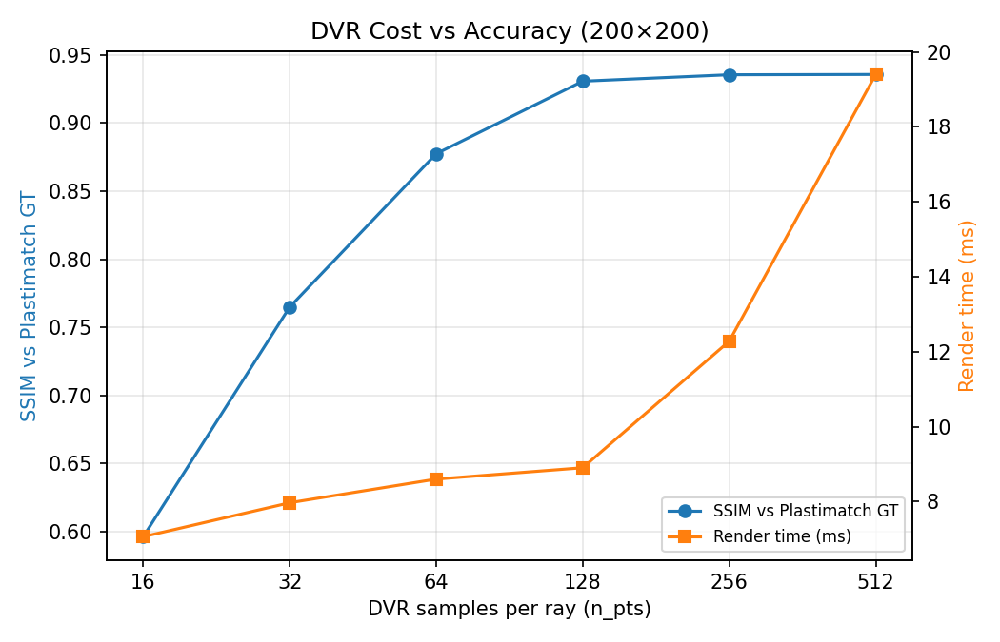

# DRR Benchmarking Engine

[](LICENSE)

A benchmarking suite for Digitally Reconstructed Radiographs (DRRs) — lets you compare different
DRR generation algorithms for medical imaging research (CVPR/MICCAI-style work) under a shared,
strictly-aligned geometry, so speed/quality comparisons across engines are actually apples-to-apples.

## Supported renderers

1. **Plastimatch (ground truth):** CPU exact geometric ray-tracing. Verified to implement the real
   Beer-Lambert attenuation law via exact Siddon integration with a physically-calibrated
   HU→attenuation conversion (see the note in `src/drr/renderers/plastimatch.py`).
2. **Monte Carlo (secondary reference, not GT):** CPU polychromatic simulation with a heuristic
   scatter blur. Despite the name it's a deterministic ray-march, not stochastic photon transport —
   useful for eyeballing beam-hardening/scatter character, not as a quality reference.
3. **DiffDRR (Siddon & Trilinear):** differentiable GPU ray-casting.
4. **DVR (PyTorch3D):** differentiable volume rendering via PyTorch3D's emission-absorption
   ray-marching.
5. **DeepDRR:** GPU physics renderer with deep-learning scatter estimation.

See [`docs/METHODOLOGY.md`](docs/METHODOLOGY.md) for the physics and math behind each renderer —
what equation each one is actually solving, and where they differ.

## Prerequisites

- **OS:** Linux recommended (needed for DeepDRR); Windows works for everything else.
- **GPU:** NVIDIA, CUDA-capable.
- **Python:** 3.10+ (uv recommended for dependency management).
- **Plastimatch:** installed system-wide.

## Installation

### 1. Virtual environment (uv)
```bash
# pip install uv, if you don't have it
uv venv --python 3.10

# Windows:
.venv\Scripts\activate
# Linux/macOS:
source .venv/bin/activate
```

### 2. PyTorch & PyTorch3D
```bash
uv pip install torch torchvision torchaudio --index-url https://download.pytorch.org/whl/cu128
```

PyTorch3D (needed for DVR) has to be built from source:
```bash
uv pip install fvcore iopath
# --no-build-isolation so the build script can see the PyTorch you just installed
uv pip install "git+https://github.com/facebookresearch/pytorch3d.git" --no-build-isolation
```

### 3. The rest
```bash
uv pip install -r requirements.txt
```
This also installs the `drr` package itself in editable mode.

### 4. Plastimatch
Needs to be on `PATH`.
- **Ubuntu 22.04+:** it's gone from the apt archives (`apt-get install plastimatch` fails with "no
  installation candidate" even with `universe` enabled). Use `sudo snap install plastimatch`
  instead.
- **Older Ubuntu/Debian:** `sudo apt-get install plastimatch` still works.
- **Windows:** grab the installer from plastimatch.org and add it to your PATH.

If you go the snap route, note it runs under strict confinement with its own private `/tmp` — see
the Plastimatch entry in "Bugs fixed along the way" below if `generate_plastimatch_drr` ever starts
silently producing nothing.

### 5. DeepDRR
Linux + CUDA only.
```bash
# CUDA 11.x
uv pip install deepdrr[cuda11x]
# CUDA 12.x (including 12.8)
uv pip install deepdrr[cuda12x]
```
DeepDRR's `cuda-python` dependency is unbounded, so a fresh install can pull `cuda-python>=13`,
which dropped the `from cuda import cudart` shim DeepDRR still imports (you'll see `cannot import
name 'cudart' from 'cuda'`). If that happens:
```bash
uv pip install "cuda-python<13"
```

### 6. Jupyter kernel, for the sanity check
```bash
uv pip install ipykernel
python -m ipykernel install --user --name drr_env --display-name "Python (DRR)"
```

## Usage

### Sanity check
Before running the full benchmark, open `notebooks/sanity_check.ipynb` and run all cells. It
renders one CT volume through all five engines and plots them side by side so you can confirm the
anatomy lines up — no scale or polarity issues — before trusting anything downstream.

### Running benchmarks
`scripts/run_benchmark.py` runs all seven: speed, VRAM footprint, image quality (PSNR/SSIM vs.
ground truth), optimization convergence, multi-view compatibility, quality-vs-resolution, and
DVR's ray-sample-count cost/accuracy ablation.

```bash
# Default: built-in DiffDRR example CT (or a synthetic phantom if that's unavailable)
python scripts/run_benchmark.py

# Your own volume
python scripts/run_benchmark.py --ct path/to/your/volume.nii.gz

# Custom resolution/iterations
python scripts/run_benchmark.py --ct data/sample.nii.gz --size 128 --resolutions 100 200 300 500 --opt-iters 300

# The two sweeps (both default to powers of 2)
python scripts/run_benchmark.py --quality-resolutions 64 128 256 512 --dvr-npts 16 32 64 128 256 512
```

Plots and a JSON summary land in `./benchmark_results`.

## Sample results

Captured with `python scripts/run_benchmark.py --resolutions 128 256 512 1024 --quality-resolutions 128 256 512 1024`
on the default DiffDRR example chest CT (resampled to 128³):

- **GPU:** NVIDIA TITAN RTX (24 GB), driver 580.17, CUDA 12.4
- **Stack:** PyTorch 2.6.0+cu124, PyTorch3D 0.7.9 (built from source), DiffDRR 0.6.1, DeepDRR 1.2.2,
  Plastimatch 1.10.0 (via snap — see the note above)

### Rendering speed (ms/frame, mean ± std)

| Resolution | DVR (PyTorch3D) | DiffDRR (Siddon) | DeepDRR |
|---|---|---|---|
| 128×128 | 9.5 ± 1.0 | 5.6 ± 0.4 | 164.5 ± 57.3 |
| 256×256 | 18.8 ± 3.6 | 19.6 ± 0.8 | 183.0 ± 44.5 |
| 512×512 | 56.5 ± 2.1 | 89.4 ± 3.5 | 303.2 ± 126.6 |
| 1024×1024 | 279.3 ± 4.9 | 463.0 ± 130.4 | 1193.1 ± 283.1 |


DeepDRR is the slowest by a wide margin — its forward pass rasterizes meshes, runs the DL scatter
model, and re-segments the volume by thresholding on every single call, none of which the two pure
ray-casters have to do. All three now complete every resolution up to 1024×1024 without OOMing;
see the VRAM section for what that took.

### VRAM footprint (MB, peak)

| Resolution | DVR fwd | DVR fwd+bwd | DiffDRR fwd | DiffDRR fwd+bwd | DeepDRR fwd |
|---|---|---|---|---|---|
| 128×128 | 328.9 | 433.1 | 387.6 | 629.7 | 80.8 |
| 256×256 | 1067.4 | 1412.1 | 1344.0 | 2313.7 | 82.1 |
| 512×512 | 3959.5 | 5266.5 | 1161.8 | 3983.5 | 88.2 |
| 1024×1024 | 15514.2 | 20670.2 | 1212.3 | 14528.1 | 108.3 |


DeepDRR's number is a PyTorch-visible approximation only — it's forward-only and allocates through
`cupy` internally, which PyTorch's memory counters can't see (see the note in `run_vram`).

<details>
<summary>Fixing the OOMs this table used to show at 1024×1024 (2026-09-02)</summary>

Both DiffDRR and DeepDRR used to OOM at 1024×1024 in this same sweep, for unrelated reasons.

DiffDRR's exact Siddon integration renders the entire image as one batch of rays, so its memory use
scales with total pixel count with no cap — at 1024×1024 the backward pass wanted something like
36GB on a 24GB card. Fix: `build_diffdrr_renderer` now passes `patch_size=256` +
`checkpoint_gradients=True` to `DRR(...)` once `image_size > 256` (`_diffdrr_memory_kwargs` in
`diffdrr.py`). This makes `DRR.render()` chunk the ray array into patches, render each through the
same call, and concatenate the results — same output (SSIM vs. Plastimatch GT is unchanged before
and after), just with memory bounded by one patch instead of the whole image. Side effect: DiffDRR's
VRAM is now actually lower than DVR's above 256px, since DVR has no equivalent chunking.

DeepDRR's OOM was a red herring — its `cupy.zeros` allocation failed while cupy's own pool showed
only ~264MB used, nowhere close to the card's limit. The real problem is that DeepDRR allocates
through `cupy`, a completely separate CUDA allocator from PyTorch's. Since every benchmark loop
here runs DVR → DiffDRR → DeepDRR back to back, PyTorch can be sitting on several idle-but-reserved
GB that `cupy` can't see until it's released. Fix: `generate_deepdrr_drr` now calls
`torch.cuda.empty_cache()` before rendering. Also dropped `max_mesh_hits` from 32 to 8, since a
single thresholded volume only has 2-3 materials and a ray never needs anywhere near 32 hits — a
smaller, secondary saving.

`run_speed`/`run_vram`/`run_resolution_sweep` still wrap each renderer's call in its own
try/except, added the same day — belt and suspenders for resolutions nobody's tested yet, so a
future OOM logs and skips instead of taking the whole run down.

</details>

### Image quality vs. ground truth (200×200)

Plastimatch (exact Siddon ray-tracing, no noise or scatter) is the sole ground truth — see
`src/drr/renderers/plastimatch.py` for how that was verified. Monte Carlo isn't GT — it's scored
against Plastimatch just like everything else below, and its higher error is expected: it's
deliberately modeling beam-hardening and scatter that Plastimatch doesn't. DVR and DiffDRR are
themselves exact/deterministic ray-marchers like Plastimatch, which is why they track it so
closely — that's not circular, it's the expected result of comparing like with like.

| Method | RMSE vs Plastimatch (GT) | PSNR vs Plastimatch (GT) | SSIM vs Plastimatch (GT) |
|---|---|---|---|
| DVR | 2.855e-02 | 30.89 | 0.9356 |
| DiffDRR (Siddon) | 2.430e-02 | 32.29 | 0.9113 |
| DiffDRR (Trilinear) | 3.681e-02 | 28.68 | 0.9272 |
| DeepDRR | 1.258e-01 | 18.00 | 0.8432 |
| Monte Carlo (secondary ref) | 1.821e-01 | 14.79 | 0.8558 |


DeepDRR and Monte Carlo diverge more from Plastimatch by design, since they're modeling
scatter/beam-hardening that a noise-free exact renderer doesn't have — higher error here reflects a
modeling difference, not a defect. Both numbers moved a lot over this project's history, but none
of that was an actual quality change — it was all fixing output-orientation bugs (see "Bugs fixed
along the way" below).

### 2D/3D registration convergence (±15° yaw perturbation, Adam + ZNCC loss)

| Method | Converged | Time (s) | Final ZNCC |
|---|---|---|---|
| DVR | iter 18 | 0.51 | 0.9900 |
| DiffDRR | iter 19 | 0.31 | 0.9901 |


Both differentiable renderers recover the perturbed pose in under 20 iterations and under a second,
landing at essentially the same final ZNCC.

### Multi-view compatibility

All the bugs documented below were caught by eye on the default AP view only — a renderer agreeing
with GT on one view says nothing about the others. `run_multiview` (added 2026-09-02) re-renders
all five renderers across six views every time you run the benchmark: AP, PA (reversed AP), two
opposite laterals, an oblique view with an offset isocenter, and a deliberately degenerate
cranial-caudal view (looking straight down the axis the default up vector also points along).


SSIM vs. Plastimatch GT, per view:

| View | Monte Carlo | DVR | DiffDRR (Siddon) | DeepDRR |
|---|---|---|---|---|
| AP | 0.856 | 0.936 | 0.911 | 0.843 |
| PA | 0.864 | 0.938 | 0.913 | 0.861 |
| Lateral +X | 0.815 | 0.927 | 0.904 | 0.792 |
| Lateral −X | 0.801 | 0.933 | 0.915 | 0.778 |
| Oblique + isocenter offset | 0.842 | 0.975 | 0.969 | 0.935 |
| Cranial-caudal (edge case) | 0.737 | 0.921 | 0.903 | 0.648 |

The headline here is that DVR and DiffDRR hold 0.90+ SSIM on every view, including the degenerate
one — geometric alignment isn't just an AP-view coincidence. Monte Carlo and DeepDRR sit lower and
vary more, which tracks with them intentionally modeling scatter, not with any misalignment — all
five renderers show the same silhouette, position, and orientation in every column of the grid
above. Chest radiography never actually uses a cranial-caudal view; it's in the sweep specifically
to shake out axis-parallel bugs, and it did (see below).

### Quality vs. resolution (`run_resolution_sweep`)

`run_quality` above is pinned to a single 200×200 render; this sweeps resolution instead
(`--quality-resolutions`, powers of 2, default `64 128 256 512`; the run below used
`128 256 512 1024`) to see whether fidelity holds as resolution changes. All four non-GT renderers
now complete every size up to 1024×1024 (see the OOM fixes above).


The interesting part isn't a flat line: DiffDRR's SSIM dips in the middle of the range (0.93 at
128px → 0.90 at 512px) before recovering to 0.92 at 1024px, while DVR stays in a tighter band
(0.93–0.96) and trends upward at the high end. SSIM is a local-window metric, so this looks like
two exact integrators (DiffDRR vs. Plastimatch) disagreeing at a sub-pixel level that only becomes
visible once there are enough pixels per anatomical structure for SSIM's window to pick it up —
not DiffDRR actually getting worse. Worth re-checking if you touch either renderer's geometry.
DeepDRR's SSIM just climbs across the range (0.85 → 0.91 at 1024px, its best score in the sweep).

### DVR cost vs. accuracy (`run_dvr_sampling_ablation`)

Sweeps DVR's `n_pts` (samples per ray, `--dvr-npts`, default `16 32 64 128 256 512`) at a fixed
200×200, scoring quality vs. GT and render time at each setting. DiffDRR isn't in this one on
purpose — its Siddon and Trilinear renderers are exact/analytic integrators with no sample-count
parameter at all (checked via `inspect.signature` against `diffdrr` 0.6.1), so there's nothing to
sweep.



Classic diminishing returns: SSIM climbs steeply from 0.60 at `n_pts=16` to 0.93 at `n_pts=128`,
then barely moves through `n_pts=512` (0.936), while render time keeps climbing linearly (9ms →
17ms). `n_pts=128` is close to the sweet spot for this CT size; the `n_pts=320` default used
elsewhere in the suite is comfortably past that point, trading speed for a bit of accuracy margin.

<details>
<summary>Bugs fixed along the way (2026-08-30 – 2026-09-01)</summary>

**Dtype bugs in the registration path.** Two latent bugs only showed up once an actual CUDA
registration run went end-to-end — previously masked by an overly broad `except ImportError` that
swallowed the `RuntimeError` a partial run threw instead of surfacing it.
`build_dvr_renderer` normalized its view/up vectors with `v / np.linalg.norm(v)`; under NumPy
≥2.0's promotion rules that silently upcasts a float32 array to float64, so the camera's R/T came
out as double instead of float. Fixed by casting back to float32 at the numpy→torch boundary.
Separately, `run_optimization`'s ±15° perturbation matrix was built from `np.cos`/`np.sin` of a
Python float, which still return float64 scalars — that made the whole tensor infer as float64 and
crash the matmul against the (now-fixed) float32 ground-truth camera. Fixed by pinning
`dtype=torch.float32` explicitly. While in there, widened the `try/except ImportError` around both
registration blocks to `except Exception`, matching the "degrade gracefully" contract the rest of
the codebase follows.

**DeepDRR was rendering the wrong field of view.** Caught by eye on the quality-comparison plot —
DeepDRR's frame didn't match the other four (visibly cropped/zoomed), and it scored worst on every
metric despite being the renderer meant to track Monte Carlo closely. The bug: `generate_deepdrr_drr`
transposed the volume to `(Z, Y, X)`, assuming `deepdrr.Volume.from_hu` follows the same convention
as Plastimatch's raw `sitk.GetImageFromArray`. It doesn't — `Volume.from_parameters` hard-codes its
own ijk→LPS mapping and actually wants `(X, Z, Y)` order with the Z axis reversed. That left
DeepDRR's camera looking down a different world axis than everything else, confirmed by projecting
single-axis marker phantoms and checking their positions against Monte Carlo's output. Fixing the
transpose — and removing the output transpose+mirror that had been silently compensating for it — took DeepDRR from worst to best on
every quality metric (PSNR 9.72 → 21.09 dB, SSIM 0.343 → 0.820) and made its framing visually match
the other four across AP, lateral, and oblique views.

**DiffDRR was mirrored.** Same symptom class, found the same way in a later pass: DiffDRR's Siddon
and Trilinear renders were horizontally flipped relative to the other three — clavicle curve,
mediastinal shadow, diaphragm asymmetry, all on the wrong side. `build_diffdrr_renderer` was
wrapping its `DRR` module in `torch.flip(img, dims=[-1])` on the assumption that DiffDRR's
right-handed camera needs it. It doesn't, at least not with the reorientation matrix (`[-r, -d,
u]`) this function already builds — that matrix alone gets the orientation right, and the extra
flip was itself the mirror. The same wrong flip had been copy-pasted into two other places that
don't go through `build_diffdrr_renderer` (`run_quality`'s trilinear branch and
`run_optimization`'s registration loop) and got removed from both. Fixing all three corrected
DiffDRR's quality numbers too, since it had been getting penalized for being mirrored, not for
being worse: SSIM went from ~0.51 to ~0.79-0.83.

**DeepDRR's PA view came out unrecognizable.** Turned up once every renderer got tested across
multiple views instead of just AP — SSIM cratered to 0.36 (usual ~0.82), and the cranial-caudal
edge case was off too. This one's a bug in the third-party `deepdrr` package, not this codebase:
`SimpleDevice.set_view()` decides its ray frame's up-axis is "already aligned" by checking
`cross(...).norm() < 1e-6`, but that norm is also ~0 when the two vectors are antiparallel — a case
that actually needs a 180° rotation `set_view()` never applies. No error, no warning, just a
rotated image for specific view/up combinations. `generate_deepdrr_drr` now runs its own probe
after every `set_view()` call and rotates the output 180° when it detects the antiparallel case.
Fixed DeepDRR's PA score (0.36 → 0.82) and cranial-caudal score (0.56 → 0.79) without touching the
other four already-correct views.

**Plastimatch was silently doing nothing.** `generate_plastimatch_drr` exited 0 with no error but
never produced a file. Not a geometry bug — Plastimatch isn't in Ubuntu 22.04's apt archives
anymore, so the only easy install path is `sudo snap install plastimatch`, and that snap runs
under strict confinement with its own private `/tmp`. `generate_plastimatch_drr`'s
`tempfile.TemporaryDirectory()` was defaulting to the host's `/tmp`, invisible to the confined
snap — hence the silent no-op. Confirmed directly: the same `plastimatch drr` command against
`/tmp` produced nothing, against `$HOME` (which the snap can see) worked immediately. Fixed by
pointing `TemporaryDirectory(dir=...)` at `$HOME`, which works for snap and non-snap installs
alike. If you hit this again with a different install method, check `snap connections
plastimatch` for what paths it can actually reach.

</details>

## Geometric configuration

All renderers align to a shared physical geometry defined in `src/drr/renderers/config.py`:
- Source-to-Detector Distance (SDD): 1020.0 mm
- Source-to-Axis Distance (SAD): 850.0 mm
- Default projection: AP (anterior-posterior)

Change this and it propagates to all five engines automatically, keeping the 1:1 mapping intact.

## License

This project is part of a research initiative. Respect the licenses of the underlying engines
(DiffDRR, PyTorch3D, DeepDRR, Plastimatch) when distributing your work.
