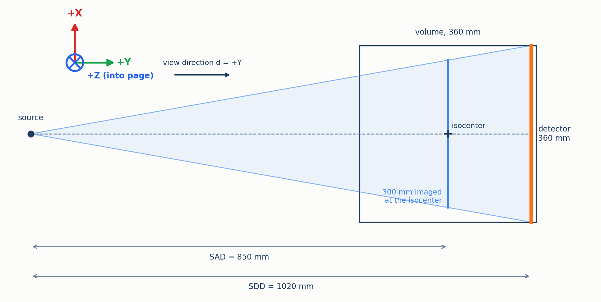
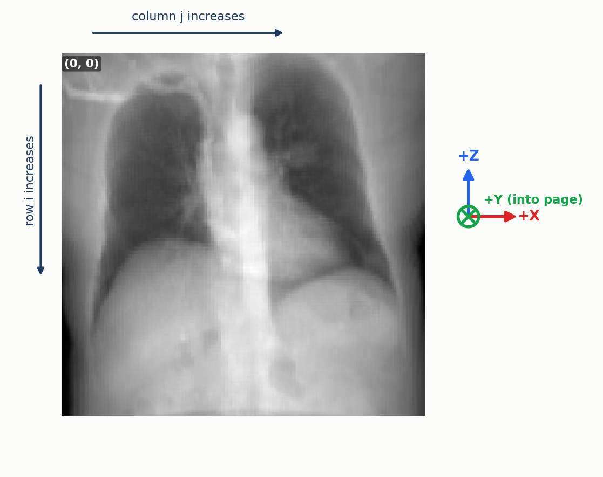

# Conventions

*(part of [Documentation Guide](INDEX.md))*

Every renderer in this suite is configured from the same small set of parameters, so that all
five image the same volume from the same place and their outputs can be compared pixel by pixel.
This document is the reference for those parameters. For each one it gives the symbol used in the
other documents, the unit, the default, what it means physically, and how each renderer receives
it. [METHODOLOGY.md](METHODOLOGY.md) §2 explains *why* the geometry is set up this way and which
mistakes it guards against. This document records *what* the conventions are.

## Contents

1. [Geometry parameters](#1-geometry-parameters)
2. [Derived quantities](#2-derived-quantities)
3. [Coordinate frames and image orientation](#3-coordinate-frames-and-image-orientation)
4. [The volume](#4-the-volume)
5. [The output image](#5-the-output-image)
6. [Sampling parameters](#6-sampling-parameters)
7. [How each renderer receives the parameters](#7-how-each-renderer-receives-the-parameters)
8. [Checklist for a new renderer](#8-checklist-for-a-new-renderer)

---

## 1. Geometry parameters

All geometry lives in one dataclass, `GeometryConfig` in `src/drr/renderers/config.py`, whose
default instance is `DEFAULT_GEOMETRY`. All lengths are in millimetres of world space.

| Field | Symbol | Default | Meaning |
|---|---|---|---|
| `sdd` | $`\mathrm{SDD}`$ | 1020.0 mm | **Source-to-detector distance**: from the X-ray focal spot to the detector plane, measured along the central ray. Called **SID** (source-to-image distance) by Plastimatch and clinical C-arms. |
| `sad` | $`\mathrm{SAD}`$ | 850.0 mm | **Source-to-axis distance**: from the focal spot to the isocenter, the point the system rotates about. Always smaller than SDD. |
| `isocenter_x`, `_y`, `_z` | $`\mathbf{I}_w`$ | (0, 0, 0) mm | **Isocenter** in world coordinates. The volume is centred on the world origin (§4), so a non-zero isocenter aims the system off the volume's centre. |
| `view_dir_x`, `_y`, `_z` | $`\mathbf{d}`$ | (0, 1, 0) | **View direction**: from the source towards the detector. +Y is an anterior–posterior (AP) view. Normalised before use. |
| `up_vec_x`, `_y`, `_z` | $`\mathbf{u}`$ | (0, 0, 1) | **Up vector**: the world direction that should appear at the top of the image. Need only be roughly perpendicular to $`\mathbf{d}`$; it is re-orthogonalised (§3). Must not be parallel to $`\mathbf{d}`$. |

<p align="center">
  
  <br><em>Figure 1. The default geometry to scale, seen along the world Z axis: +X up, +Y to the right, and +Z into the page, so the axes are right-handed (X × Y = Z). The fan of rays covers the whole 360&nbsp;mm detector, but only a 300&nbsp;mm wide slice of the volume at the isocenter, because the detector sits beyond it. The detector plane, 170&nbsp;mm past the isocenter, also passes 10&nbsp;mm inside the volume's 180&nbsp;mm half-width (§2).</em>
</p>

## 2. Derived quantities

The renderers also need a few values that follow from §1 and from the volume. Writing $`D`$ for
the volume's side in voxels, $`s`$ for its voxel spacing and $`W`$ for the output image's side in
pixels:

| Quantity | Formula | Default value | Used for |
|---|---|---|---|
| Volume side | $`L = D\,s`$ | 360 mm (example CT, $`D = 128`$, $`s = 2.81`$ mm) | Detector size; normalised-coordinate scale (DVR) |
| Detector side | $`L`$ | 360 mm | The detector is always as wide as the volume |
| Pixel pitch | $`p = L / W`$ | 1.8 mm at $`W = 200`$ | Detector sampling |
| Source position | $`\mathbf{S} = \mathbf{I}_w - \mathrm{SAD}\,\mathbf{d}`$ | (0, −850, 0) mm | Origin of every ray |
| Detector centre | $`\mathbf{C} = \mathbf{I}_w + (\mathrm{SDD} - \mathrm{SAD})\,\mathbf{d}`$ | (0, 170, 0) mm | Where the central ray meets the detector |
| Magnification | $`M = \mathrm{SDD} / \mathrm{SAD}`$ | 1.2 | Size on the detector of an object at the isocenter |
| Field at the isocenter | $`L / M`$ | 300 mm | Width of the volume actually imaged at its centre |
| Focal length in pixels | $`f = \mathrm{SDD} / p = \mathrm{SDD}\,W / L`$ | 566.7 px at $`W = 200`$ | Pinhole intrinsics (DVR) |
| Fan half-angle | $`\arctan\big(L / (2\,\mathrm{SDD})\big)`$ | 10.0° (14.0° to a corner) | Off-axis ray obliquity |

Three consequences follow. The detector being as wide as the volume, and the volume sitting nearer
the source than the detector, means about 30 mm on each side of the volume falls outside the
field. Because $`\mathrm{SDD} - \mathrm{SAD} = 170`$ mm is less than $`L/2 = 180`$ mm, the detector
plane lies 10 mm inside the volume's box. Plastimatch, DiffDRR and Monte Carlo end each ray at the
detector; DVR and DeepDRR continue past it. In the AP view that last 10 mm is air, but in a view
where tissue reaches the edge of the box the two groups integrate slightly different paths. And a renderer that placed its detector at the isocenter, or used SAD where SDD belongs,
would still produce a plausible image — only at the wrong magnification — which is why these
values are checked against each other rather than by eye.

## 3. Coordinate frames and image orientation

**World frame.** Right-handed, in millimetres, with the volume centred on the origin. For the
example CT, $`+Z`$ runs from feet to head, $`+X`$ across the patient, and $`+Y`$ through the
patient along the default view direction, which this suite labels AP.

**Camera basis.** Every renderer derives the same orthonormal basis from $`\mathbf{d}`$ and
$`\mathbf{u}`$:

```math
\mathbf{r} = \frac{\mathbf{d}\times\mathbf{u}}{\lVert\mathbf{d}\times\mathbf{u}\rVert},
\qquad
\mathbf{u}' = \mathbf{r}\times\mathbf{d}
```

**Image orientation.** Image columns increase along $`\mathbf{r}`$, and image rows increase along
$`-\mathbf{u}'`$, so $`\mathbf{u}'`$ points to the top row. For the default AP view,
$`\mathbf{r} = +X`$ and $`\mathbf{u}' = +Z`$: the head is at the top and $`+X`$ is on the right of
the image, with $`+Y`$, the view direction, pointing into the page.

<p align="center">
  
  <br><em>Figure 2. Image axes for the default AP view, drawn on the actual Plastimatch render of the example CT. Columns j run to the right, along +X; rows i run downward, along −Z; pixel (0, 0) is the top-left corner. The colours of the world axes match Figure 1.</em>
</p>

**Pixel positions.** The detector is square, $`W \times W`$ pixels. Pixel $`(i, j)`$ — row $`i`$, column $`j`$, both from 0 — is centred at

```math
\mathbf{C} + \Big(j - \tfrac{W-1}{2}\Big)\,p\,\mathbf{r} - \Big(i - \tfrac{W-1}{2}\Big)\,p\,\mathbf{u}'
```

**Degenerate up vector.** If $`\mathbf{u}`$ is parallel to $`\mathbf{d}`$, $`\mathbf{r}`$ is
undefined, so such a configuration must supply a different up vector. The multi-view benchmark's
cranial–caudal view looks along the default up axis and therefore uses $`\mathbf{u} = +Y`$
([RESULTS.md](RESULTS.md) §6).

## 4. The volume

**Tensor layout.** The volume is a `torch.Tensor` of shape `(1, 1, D, D, D)` whose three spatial
axes are world $`X`$, $`Y`$, $`Z`$, in that order. Renderers whose libraries expect another order
permute it themselves (§7).

**Voxel positions.** Every renderer places voxel $`(i, j, k)`$ with its centre at

```math
\Big(\big(i - \tfrac{D-1}{2}\big)s,\ \ \big(j - \tfrac{D-1}{2}\big)s,\ \ \big(k - \tfrac{D-1}{2}\big)s\Big)
```

a grid centred exactly on the world origin, spanning $`[-\tfrac{Ds}{2},\ \tfrac{Ds}{2}]`$ on each
axis. Each renderer's library states voxel positions differently (§7), and getting this wrong by
half a voxel is easy and invisible by eye. It was checked by projecting a small off-centre cube
through all five renderers, in an AP and a lateral view, and comparing the centroid of its image
with the analytic projection of its centre: all five agree to within 0.3 pixels.

**Spacing.** One isotropic spacing $`s`$ for all three axes. A scan with anisotropic voxels is
resampled to isotropic voxels that keep each axis's true physical length, and the shorter axes are
padded with air to a cube ([DATA.md](DATA.md) §1). For the example CT this gives $`s = 2.81`$ mm
and $`L = 360`$ mm.

**Density encoding.** Each voxel stores a normalised density $`\rho \in [0,1]`$ derived from its
Hounsfield value:

```math
\rho =
\begin{cases}
0, & \mathrm{HU} \le -800 \\
\dfrac{\min(\mathrm{HU},\ 3000) + 1000}{4000}, & \mathrm{HU} > -800
\end{cases}
\qquad\qquad
\mathrm{HU} = 4000\,\rho - 1000
```

The cutoff is the one Plastimatch's own attenuation lookup applies: it treats everything at or
below −800 HU as air, with zero attenuation. Building it into the encoding makes $`\rho`$ exactly
proportional to the benchmark reference's attenuation for every voxel. The inverse on the right recovers
the original HU exactly in $`(-800, 3000]`$; everything at or below −800, including most lung, comes
back as air at −1000 HU, and values above 3000 are clipped to 3000. The density $`\rho`$ is an
encoding of HU, not a physical mass density; renderers that need a mass density derive it from HU
themselves ([DeepDRR](methods/deepdrr.md) §1). Encoding and decoding are `hu_to_density` and `density_to_hu` in
`src/drr/data.py`; renderers that need HU call `density_to_hu` rather than reimplementing it.

## 5. The output image

**Display convention.** Every renderer returns attenuation, not transmission: bright where the
ray met much dense matter, dark where it met little ([METHODOLOGY.md](METHODOLOGY.md) §1).

**Shape and range.** Every renderer returns a `(1, 1, W, W)` tensor. The three non-differentiable
renderers rescale their output to $`[0,1]`$ themselves; DVR rescales when called with
`norm_type="normalized"`; DiffDRR returns raw line-integral values.

**Comparison.** Before any metric is computed, both images are rescaled to $`[0,1]`$ by their own
minimum and maximum (`compute_metrics`, `src/drr/utils/metrics.py`). Absolute scale and offset
therefore never affect a comparison; only the relative brightness of different pixels does
([METHODOLOGY.md](METHODOLOGY.md) §3.2).

## 6. Sampling parameters

Samples per ray, for the default volume and geometry, on the central ray:

| Renderer | Parameter | Default | Where the samples fall | Central ray |
|---|---|---|---|---|
| Plastimatch | `-i exact` | — | One segment per voxel crossed, exact length, to the detector | about 125 segments |
| DiffDRR, Siddon | `renderer="siddon"` | — | One segment per voxel crossed, exact length, to the detector | about 125 segments |
| DiffDRR, trilinear | `n_points` | 500 | Evenly between where the ray enters the volume and the detector | 500, about 0.7 mm apart |
| DVR | `n_pts` (`--n-pts`) | 320 | Evenly in camera depth over $`\mathrm{SAD} \pm L`$ | about 160 inside the volume, 2.25 mm apart |
| Monte Carlo | `n_pts` | 128 | Evenly between where the ray enters the volume and the detector | 128, about 2.7 mm apart |
| DeepDRR | `step` (library) | 0.1 mm | Fixed step between volume entry and exit | about 3600 |

## 7. How each renderer receives the parameters

### 7.1 Plastimatch

The volume is written to an MHA file in HU, transposed to the $`(Z, Y, X)`$ order SimpleITK
expects, with spacing $`s`$ and origin $`-(D-1)s/2`$ on each axis. ITK's origin is the centre of
the first voxel, so this places voxel centres as in §4.

| Parameter | Command-line option |
|---|---|
| Image size $`W`$ | `-r "W W"` |
| Detector size $`L`$ | `-z "L L"` |
| $`\mathbf{I}_w`$ | `-o "x y z"` |
| $`\mathrm{SDD}`$ | `--sid` |
| $`\mathrm{SAD}`$ | `--sad` |
| $`\mathbf{d}`$ | `-n` with $`-\mathbf{d}`$: the option is the detector's normal, which points back at the source |
| $`\mathbf{u}`$ | `--vup` |

### 7.2 DiffDRR

| Parameter | How it is passed |
|---|---|
| Volume | A TorchIO subject from `make_diffdrr_subject`: affine with diagonal $`s`$ and offset $`-Ds/2`$, plus the fixed AP reorientation of [DATA.md](DATA.md) §2; DiffDRR places voxel centres as in §4 from this affine |
| $`\mathrm{SDD}`$, $`W`$, $`p`$ | `DRR(subject, sdd=SDD, height=W, delx=p)` |
| $`\mathbf{d}`$, $`\mathbf{u}`$ | Rotation with columns $`(-\mathbf{r}, -\mathbf{d}, \mathbf{u}')`$, passed as ZXY Euler angles |
| $`\mathbf{I}_w`$, $`\mathrm{SAD}`$ | Translation $`(-\mathbf{r}\cdot\mathbf{I}_w,\ -\mathbf{d}\cdot\mathbf{I}_w + \mathrm{SAD},\ \mathbf{u}'\cdot\mathbf{I}_w)`$ |
| Memory bound | `patch_size=256`, `checkpoint_gradients=True` above 256×256 |

### 7.3 DVR

The library works in a normalised cube $`[-1, 1]^3`$, so every length is multiplied by $`2/L`$.
The volume tensor is permuted to $`(Z, Y, X)`$, because the library's sampler reads the last axis as
$`X`$.

| Parameter | How it is passed |
|---|---|
| $`\mathbf{d}`$, $`\mathbf{u}`$ | Camera rotation with columns $`(\mathbf{u}\times\mathbf{d},\ \mathbf{u}',\ \mathbf{d})`$ — the library's left, up, forward axes |
| $`\mathbf{I}_w`$, $`\mathrm{SAD}`$ | Camera centre $`\mathbf{S}\cdot 2/L`$, through the translation $`T = -\mathbf{S}_{\text{n}}R`$ |
| $`\mathrm{SDD}`$, $`W`$, $`L`$ | Focal length $`f = \mathrm{SDD}\,W/L`$ in pixels, principal point $`(W/2, W/2)`$ |
| Depth range | $`[\mathrm{SAD}_{\text{n}} - 2,\ \mathrm{SAD}_{\text{n}} + 2]`$ normalised units, i.e. $`\mathrm{SAD} \pm L`$ |

### 7.4 Monte Carlo

No library: the renderer builds every ray itself, from $`\mathbf{S}`$ (§2) to each pixel position
of §3, clips it to the volume's box $`[-Ds/2, Ds/2]^3`$, and samples the volume with the voxel
positions of §4.

### 7.5 DeepDRR

| Parameter | How it is passed |
|---|---|
| Volume | `Volume.from_hu` with HU from `density_to_hu`, re-ordered and flipped into the library's own index convention, spacing $`s`$, origin $`-Ds/2`$ |
| $`W`$, $`p`$, $`\mathrm{SDD}`$ | `SimpleDevice(sensor_height=W, sensor_width=W, pixel_size=p, source_to_detector_distance=SDD)` |
| $`\mathbf{I}_w`$, $`\mathbf{d}`$, $`\mathbf{u}`$ | `set_view(point=C + I_w, direction=d, up=u, ...)`, where $`C`$ is the library's world position of index $`(D+1)/2`$: its kernel samples one index behind its own index-to-world transform, so that is where the centre voxel $`(D-1)/2`$ is actually drawn |
| $`\mathrm{SAD}`$ | `source_to_point_fraction = SAD / SDD` |
| Up-vector check | After `set_view`, the realised up direction is compared with $`\mathbf{u}'`$; if they are opposite, the image is rotated 180° ([DEVELOPMENT_NOTES.md](DEVELOPMENT_NOTES.md) §1) |
| Output | `neglog=False`; the wrapper computes $`-\log(I/I_0)`$ itself ([DeepDRR](methods/deepdrr.md) §3) |

## 8. Checklist for a new renderer

A renderer added to this suite should:

1. Take `(volume, voxel_spacing, image_size, device, geometry=None)` and fall back to
   `DEFAULT_GEOMETRY`.
2. Place voxels as in §4 and pixels as in §3 — and check this by rendering the default AP view and
   the cranial–caudal view against Plastimatch, not only the AP view.
3. Use `density_to_hu` if it needs HU.
4. Return attenuation, as a `(1, 1, W, W)` tensor.
5. Return `None` instead of raising when its dependency is missing.
