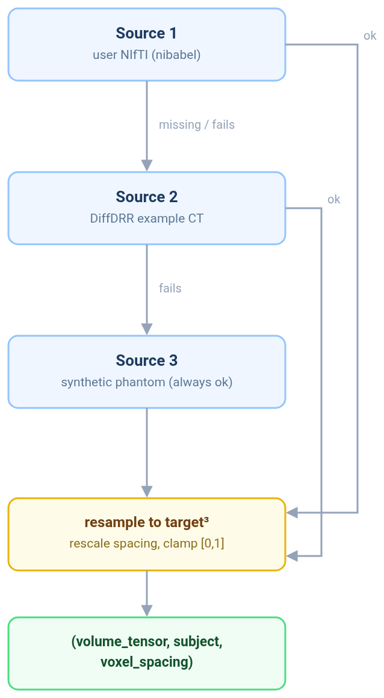
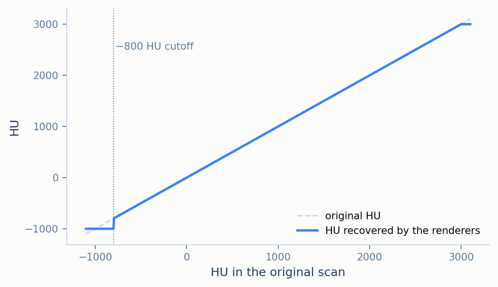
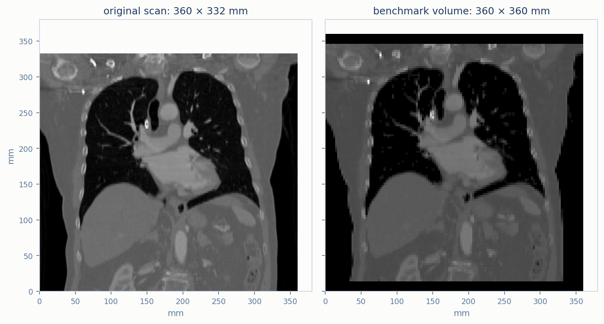

# CT Volume Loading

*(part of [Documentation Guide](INDEX.md))*

Every renderer in this suite starts from the same input: a cube of normalised density
$`\rho \in [0,1]`$ with one voxel spacing for all three axes, centred at the world origin. This
document explains how a CT scan becomes that cube. Two choices made along the way matter for
every result elsewhere: how Hounsfield units are encoded as density (§1.2), and how a scan with
non-cubic voxels is resampled without changing its physical size (§1.3). §2 covers the one extra
object DiffDRR needs, and §3 maps everything to the code. The resulting conventions are collected
in [CONVENTIONS.md](CONVENTIONS.md) §4.

## Contents

1. [From a scan to the density cube](#1-from-a-scan-to-the-density-cube)
2. [The subject object for DiffDRR](#2-the-subject-object-for-diffdrr)
3. [Mapping to the code](#3-mapping-to-the-code)
4. [References](#4-references)

---

## 1. From a scan to the density cube

### 1.1 Where the volume comes from

The loader tries three sources in order and uses the first that works.

**Source 1 — a volume supplied by the user**, read from a NIfTI file. If its values look like
Hounsfield units (its minimum is −500 or lower), it is treated as HU and encoded as in §1.2.
Otherwise it is min–max normalised to $`[0,1]`$ with a warning, since the renderers that need HU
will then not see real HU values.

**Source 2 — the example chest CT shipped with DiffDRR** [2], used when no file is given or the
file cannot be read. This is the volume behind every figure and number in this documentation: a
$`512 \times 512 \times 133`$ scan with $`0.703 \times 0.703 \times 2.5`$ mm voxels, about
360 mm across and 332.5 mm from feet to head. The loader takes its HU values directly.

**Source 3 — a synthetic phantom**, used if both of the above fail. It is generated analytically
and so cannot fail, which guarantees the pipeline always has something to render. With
$`r = \sqrt{x^2+y^2+z^2}`$ over the cube $`[-1,1]^3`$, it is a two-level sphere already in
density units:

```math
\rho = 0.3\cdot\mathbb{1}[r < 0.40] + 0.7\cdot\mathbb{1}[r < 0.15]
```

— a shell of density 0.3 with a core of density 1.0, useful for checking orientation.

<p align="center">
  
  <br><em>Figure 1. The loader's fallback order. If a volume passed with `--ct` cannot be loaded, the loader logs a warning and continues with the next source, so check the reported input source before interpreting results. Whichever source succeeds, its volume goes through the same resampling, encoding and clamping (§1.2–1.3).</em>
</p>

**Input assumptions for user-provided volumes.** A volume given with `--ct` is assumed to already follow the axis orientation the benchmark
expects: its three array axes are taken as world X, Y and Z ([CONVENTIONS.md](CONVENTIONS.md) §4),
with the default AP view looking along +Y and +Z running from feet to head. The loader uses the
voxel spacing from the NIfTI header but does not reorient the volume using the file's affine.
Two scans with the same spacing but different orientation metadata therefore do not necessarily
produce the same anatomical orientation. A volume stored in another axis order must be reoriented
before it is benchmarked.

### 1.2 Encoding HU as density

HU values are encoded with a fixed rule rather than rescaled per scan:

```math
\rho =
\begin{cases}
0, & \mathrm{HU} \le -800 \\
\dfrac{\min(\mathrm{HU},\ 3000) + 1000}{4000}, & \mathrm{HU} > -800
\end{cases}
```

so water, 0 HU, is $`\rho = 0.25`$, and +3000 HU is $`\rho = 1`$. Two reasons fix this rule.

**It is invertible within a defined HU range.** Plastimatch and DeepDRR need HU, and recover it as
$`\mathrm{HU} = 4000\rho - 1000`$. Because the rule does not depend on the scan's own range, the
original HU is recovered exactly for every voxel in $`(-800,\ 3000]`$. Voxels at or below −800 HU
become air (−1000 HU), and voxels above 3000 HU are clipped to 3000 HU, so neither can be
recovered.

**It makes density proportional to the benchmark reference's attenuation.** Plastimatch converts HU to
attenuation with $`\mu = \mu_{\text{water}}(1 + \mathrm{HU}/1000)`$, but sets $`\mu = 0`$ at or below
−800 HU ([Plastimatch](methods/plastimatch.md) §1). With the same cutoff built into the encoding,
$`\mu = 4\mu_{\text{water}}\rho`$ holds for *every* voxel, air included. The renderers that integrate
$`\rho`$ directly then compute exactly the same quantity as the benchmark reference, up to a constant
([METHODOLOGY.md](METHODOLOGY.md) §3).

<p align="center">
  
  <br><em>Figure 2. The HU value a renderer recovers from the stored density, against the original HU. Between −800 and 3000&nbsp;HU the two are identical; at or below −800&nbsp;HU everything, air and most lung, becomes −1000&nbsp;HU, and above 3000&nbsp;HU values are clipped.</em>
</p>

The cost is that tissue below −800 HU, which includes much of the lung, is treated as air by
every renderer. For DVR and DiffDRR, which integrate density directly and are judged on how closely
they match the benchmark reference, that is exactly right, since the benchmark reference does the same. For
Monte Carlo and DeepDRR, which would otherwise give lung tissue a small but non-zero attenuation,
it removes some attenuation in the lung fields ([DeepDRR](methods/deepdrr.md) §5).

HU is resampled *before* it is encoded (§1.3), so the cutoff is applied to the final voxels. No
interpolated value ends up just above zero, where Plastimatch would treat it as air but the other
renderers would not.

### 1.3 One spacing, true physical size

The renderers assume cubic voxels of a single spacing $`s`$, in a cube $`D`$ voxels on a side,
$`D = 128`$ by default. The loader gets there without changing the scan's physical size:

**1. Choose the spacing from the longest axis.** With $`e_x, e_y, e_z`$ the scan's physical extent
along each axis,

```math
s = \frac{\max(e_x,\ e_y,\ e_z)}{D}
```

**2. Resample each axis to that spacing**, by trilinear interpolation, keeping its own extent:
$`\mathrm{round}(e_i / s)`$ voxels along axis $`i`$.

**3. Pad the shorter axes with air** — −1000 HU, or density 0 — symmetrically, to $`D`$ voxels.

For the example CT, the longest extent is 360 mm, so $`s = 360/128 = 2.81`$ mm. The two in-plane
axes become 128 voxels and the 332.5 mm axis becomes 118 voxels, padded by five voxels of air at
each end. The volume's side is $`L = D\,s = 360`$ mm, the true width of the scan.

<p align="center">
  
  <br><em>Figure 3. The middle coronal slice of the example CT before (left, HU) and after (right, density) loading, on the same millimetre axes. The anatomy keeps its size and proportions; the cube is completed with air at the top and bottom. Lung below −800&nbsp;HU appears black on the right, per §1.2.</em>
</p>

Physical size matters for the two renderers that attenuate in real units. An earlier version of
the loader averaged the three spacings and forced every axis to the same voxel count instead,
which made the example CT a 667 mm cube, about 1.85 times wider and twice as tall as the patient.
That changed nothing for the renderers compared after normalisation, but it roughly doubled the
tissue path for Monte Carlo and DeepDRR ([DEVELOPMENT_NOTES.md](DEVELOPMENT_NOTES.md)).

## 2. The subject object for DiffDRR

[DiffDRR](methods/diffdrr.md) does not take a bare tensor. It takes a *subject*, an object from the
medical-imaging library TorchIO [1] that bundles the volume with an affine matrix giving each
voxel's position in millimetres. The example CT comes with one, but resampling invalidates its
affine, so the loader returns none, and the subject is always built from the final cube in three
steps.

**Centring.** For spacing $`s`$ and $`D`$ voxels per side, the subject's affine has diagonal $`s`$
and offset $`-sD/2`$ on each axis. DiffDRR reads that offset as the outer corner of the first
voxel, so voxel index $`i`$ is centred at

```math
x(i) = \Big(i - \frac{D-1}{2}\Big)\,s
```

the same centred grid every other renderer uses ([CONVENTIONS.md](CONVENTIONS.md) §4).

**AP orientation.** DiffDRR's detector is given a fixed reorientation, a 90° rotation about the
$`X`$ axis,

```math
R_{\mathrm{AP}} = \begin{pmatrix} 1 & 0 & 0 \\ 0 & 0 & -1 \\ 0 & 1 & 0 \end{pmatrix}
```

which sends $`+Y`$ to $`+Z`$ and $`+Z`$ to $`-Y`$, matching DiffDRR's internal frame to the
default view.

**Canonicalisation.** The subject is finally passed through the same canonicalisation step
DiffDRR applies to its own example data, so a rebuilt subject is indistinguishable from one
DiffDRR would have produced itself.

## 3. Mapping to the code

| Concept | Where it lives |
|---|---|
| Entry point | `load_ct_volume(ct_path, target_size)` (`src/drr/data.py`), returning `(volume_tensor, None, voxel_spacing)` |
| §1.1 Sources 1–3 | The three blocks of `load_ct_volume`, in order; Source 2 reads `diffdrr.data.load_example_ct(...).volume` (HU) |
| §1.2 encoding | `hu_to_density`, `density_to_hu`, and the constants `HU_MIN`, `HU_MAX`, `HU_AIR_CUTOFF` (`src/drr/data.py`) |
| §1.3 resampling | `_resample_to_cube` (`src/drr/data.py`); the cube size is `--size` in `scripts/run_benchmark.py` (default 128) |
| §2 subject | `make_diffdrr_subject` (`src/drr/data.py`), called by `scripts/run_benchmark.py` and the sanity-check notebook |

## 4. References

1. F. Pérez-García, R. Sparks, S. Ourselin. TorchIO: A Python library for efficient loading,
   preprocessing, augmentation and patch-based sampling of medical images. *Computer Methods and
   Programs in Biomedicine* 208, 2021.
2. V. Gopalakrishnan, P. Golland. Fast auto-differentiable digitally reconstructed radiographs for
   solving inverse problems in intraoperative imaging. *Workshop on Clinical Image-Based
   Procedures*, Springer, 2022.
