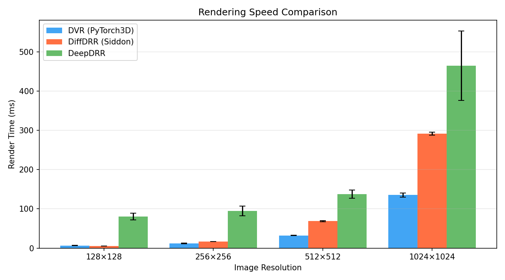
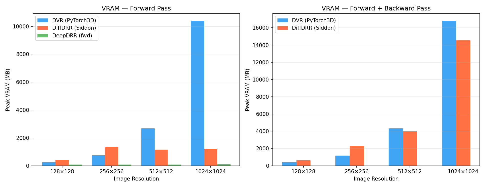
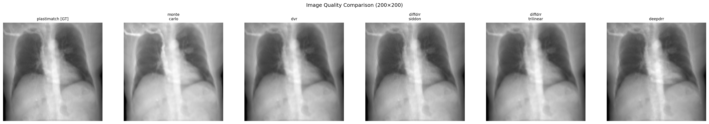
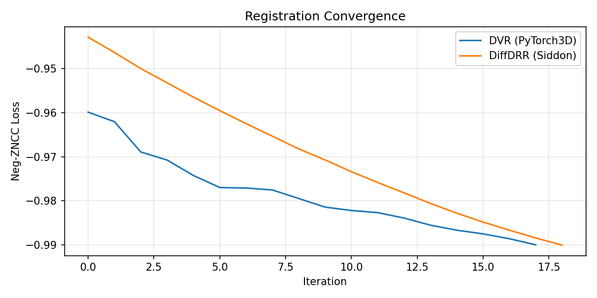
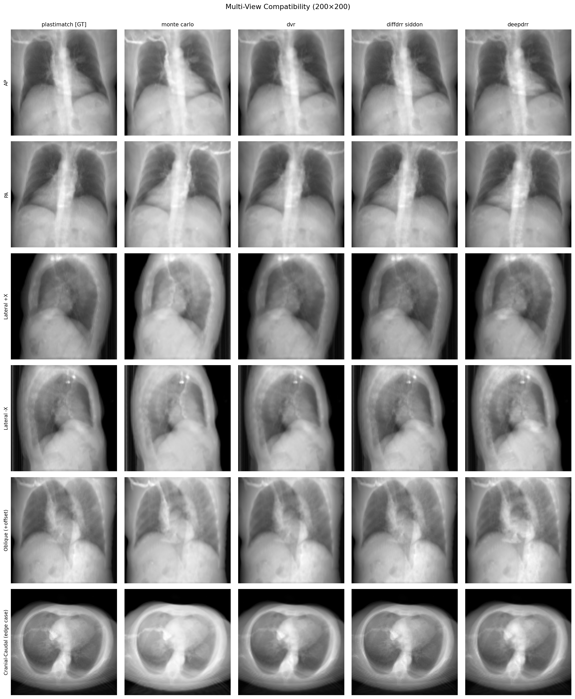
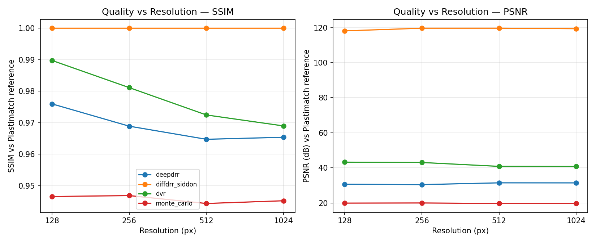

# DRR Documentation Router (`docs/INDEX.md`)

Welcome to the **DRR Benchmarking Engine** documentation suite. This repository compares five
Digitally Reconstructed Radiograph (DRR) rendering engines for medical imaging research — speed,
VRAM footprint, image quality, and 2D/3D registration convergence.

Whether you're setting up the benchmark for the first time or digging into the physics behind one
renderer, this document is your navigation map.

---

## 1. Recommended Reading Path for New Readers

If you're new to the project, read in this order:

<figure>
<svg viewBox="0 0 660 230" width="100%" style="max-width:640px;font-family:-apple-system,Segoe UI,Roboto,sans-serif" role="img" aria-labelledby="idx-fig-title idx-fig-desc">
<title id="idx-fig-title">Recommended reading order</title>
<desc id="idx-fig-desc">README leads to METHODOLOGY, which branches into the per-renderer method docs and DATA.md, both converging on CLAUDE.md.</desc>
<defs>
<marker id="idx-arrow" viewBox="0 0 10 10" refX="8.5" refY="5" markerWidth="6.5" markerHeight="6.5" orient="auto-start-reverse">
<path d="M0,0 L10,5 L0,10 z" fill="#94a3b8"></path>
</marker>
</defs>
<rect x="16" y="87" width="140" height="56" rx="8" fill="#eff6ff" stroke="#93c5fd" stroke-width="1.5"></rect>
<text x="86" y="111" text-anchor="middle" font-size="13" fill="#1e3a5f" font-weight="600">README.md</text>
<text x="86" y="127" text-anchor="middle" font-size="10.5" fill="#5b7897">Setup &amp; results</text>
<path d="M156,115 H198" stroke="#94a3b8" stroke-width="1.5" fill="none" marker-end="url(#idx-arrow)"></path>
<rect x="200" y="87" width="160" height="56" rx="8" fill="#eff6ff" stroke="#93c5fd" stroke-width="1.5"></rect>
<text x="280" y="111" text-anchor="middle" font-size="13" fill="#1e3a5f" font-weight="600">METHODOLOGY.md</text>
<text x="280" y="127" text-anchor="middle" font-size="10.5" fill="#5b7897">Physics overview</text>
<path d="M360,102 C395,102 395,45 430,45" stroke="#94a3b8" stroke-width="1.5" fill="none" marker-end="url(#idx-arrow)"></path>
<path d="M360,128 C395,128 395,185 430,185" stroke="#94a3b8" stroke-width="1.5" fill="none" marker-end="url(#idx-arrow)"></path>
<rect x="432" y="17" width="140" height="56" rx="8" fill="#eff6ff" stroke="#93c5fd" stroke-width="1.5"></rect>
<text x="502" y="41" text-anchor="middle" font-size="13" fill="#1e3a5f" font-weight="600">methods/*.md</text>
<text x="502" y="57" text-anchor="middle" font-size="10.5" fill="#5b7897">Per-renderer math</text>
<rect x="432" y="157" width="140" height="56" rx="8" fill="#eff6ff" stroke="#93c5fd" stroke-width="1.5"></rect>
<text x="502" y="181" text-anchor="middle" font-size="13" fill="#1e3a5f" font-weight="600">DATA.md</text>
<text x="502" y="197" text-anchor="middle" font-size="10.5" fill="#5b7897">CT loading</text>
<path d="M572,45 C600,45 600,105 578,105" stroke="#94a3b8" stroke-width="1.5" fill="none" marker-end="url(#idx-arrow)"></path>
<path d="M572,185 C600,185 600,125 578,125" stroke="#94a3b8" stroke-width="1.5" fill="none" marker-end="url(#idx-arrow)"></path>
<rect x="580" y="90" width="70" height="50" rx="8" fill="#eff6ff" stroke="#2b6cb0" stroke-width="2"></rect>
<text x="615" y="111" text-anchor="middle" font-size="12" fill="#1e3a5f" font-weight="600">CLAUDE</text>
<text x="615" y="126" text-anchor="middle" font-size="10.5" fill="#5b7897">.md</text>
</svg>
<figcaption>Reading order: <code>README.md</code> for setup/results, then <code>METHODOLOGY.md</code> for the shared physics, which branches into the per-renderer <code>methods/*.md</code> files and <code>DATA.md</code>, both feeding into <code>CLAUDE.md</code> for architecture and coordinate-system gotchas.</figcaption>
</figure>

1. **[`README.md`](../README.md)** — **Start here!** Installation, running the benchmarks, and the
   sample results (speed/VRAM/quality/registration/multi-view tables and plots).
2. **[`METHODOLOGY.md`](METHODOLOGY.md)** — The shared physics every renderer approximates
   (Beer-Lambert transmission/attenuation) and how the five methods compare along ray-integration,
   spectrum, and scatter axes.
3. **[`methods/`](methods)** — One file per renderer, each with a fixed `## Algorithm` +
   `## Mathematical Formulation` structure. Read whichever renderer you're touching.
4. **[`DATA.md`](DATA.md)** — How a CT volume gets from a NIfTI path (or the built-in fallbacks) to
   the `(volume_tensor, subject, voxel_spacing)` tuple every renderer consumes.
5. **[`CLAUDE.md`](../CLAUDE.md)** — Codebase architecture, the shared geometry contract, and a
   running list of coordinate-system traps that have bitten this repo before. Essential reading
   before modifying any renderer.

---

## 2. Master Documentation Directory

| Document | Primary Focus | Best For |
|:---|:---|:---|
| **[`README.md`](../README.md)** | Setup, usage, and sample results | Installing dependencies, running `scripts/run_benchmark.py`, reading the results tables/plots |
| **[`METHODOLOGY.md`](METHODOLOGY.md)** | Shared physics & cross-method comparison | Understanding what all five renderers are computing and how they trade off exactness, spectrum, and scatter |
| **[`DATA.md`](DATA.md)** | CT volume loading & fallback chain | Understanding how `load_ct_volume()` sources a volume and builds the DiffDRR subject |
| **[`CLAUDE.md`](../CLAUDE.md)** | Architecture, geometry contract & coordinate-system gotchas | Working on renderer code without reintroducing a fixed orientation/OOM bug |

---

## 3. Per-Renderer Method Docs (`docs/methods/`)

Each file follows the same two-section template: `## Algorithm` (numbered logical steps) and
`## Mathematical Formulation` (numbered, derived equations), with equation cross-references
between files where one method builds on another.

| Method | Path | Key Focus |
|:---|:---|:---|
| **Plastimatch** (ground truth) | [`methods/plastimatch.md`](methods/plastimatch.md) | Exact Siddon ray-voxel intersection, HU calibration, Beer-Lambert transmission |
| **Monte Carlo** (secondary reference) | [`methods/monte_carlo.md`](methods/monte_carlo.md) | Polychromatic ray-marching, beam hardening, Gaussian-blur scatter approximation |
| **DiffDRR** | [`methods/diffdrr.md`](methods/diffdrr.md) | Same exact line integral as Plastimatch, made differentiable for gradient-based registration |
| **DVR** | [`methods/dvr.md`](methods/dvr.md) | Graphics volume-rendering equation repurposed for attenuation, shown equivalent to Beer-Lambert |
| **DeepDRR** | [`methods/deepdrr.md`](methods/deepdrr.md) | Exact ray tracing through segmented, polychromatic materials — scatter-free in this benchmark (deprecated in the installed library) |

---

## 4. Sample Results (`assets/results/`)

Rendered comparison plots referenced from `README.md`'s "Sample results" section — speed, VRAM,
image quality, registration convergence, multi-view compatibility, and the resolution/sampling
sweeps. Not documentation in themselves; see `README.md` §"Sample results" for the tables and
narrative around each plot.

| | | |
|:---:|:---:|:---:|
|  |  |  |
| Speed | VRAM | Quality vs. Plastimatch GT |
|  |  |  |
| Registration convergence | Multi-view compatibility | Quality vs. resolution |
