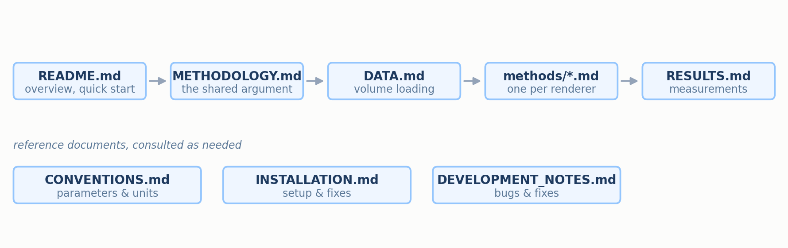

# Documentation Guide

This repository benchmarks five renderers of digitally reconstructed radiographs (DRRs) —
simulated X-ray images computed from a CT volume — for speed, GPU memory, image quality and
2D/3D registration. This page says what each document covers and in which order to read them.

## Contents

1. [Overview](#1-overview)
2. [Recommended reading order](#2-recommended-reading-order)
3. [Documents](#3-documents)
4. [Per-renderer documents](#4-per-renderer-documents)

---

## 1. Overview

Every renderer receives the same density volume and the same camera geometry. Once the benchmark
has rescaled each image to $`[0,1]`$, three of them — Plastimatch (the benchmark reference),
DiffDRR and DVR — target the same quantity, the line integral of density along each ray, using different numerical
integration schemes and implementation conventions. DiffDRR's exact mode reproduces the reference to
floating-point precision, and DVR matches it with a normalised RMSE of about 0.008. The other two,
Monte Carlo and DeepDRR, model an X-ray tube's spectrum, which makes their output a different
function of the anatomy, so their pixel values differ from the reference by design even where
their structure matches it closely.

"Benchmark reference" means the renderer against which the others are scored. It is the exact
integral of the single-energy model through the piecewise-constant voxel attenuation field, not a
measurement of a real patient.
[METHODOLOGY.md](METHODOLOGY.md) §3 derives the split between the two groups, each method document
shows where its renderer falls, and [RESULTS.md](RESULTS.md) checks it against the measurements.

## 2. Recommended reading order

  
   <em>Figure 1. Reading order. The main row is the narrative; the three reference documents below it are consulted as needed.</em>

1. **[`README.md`](../README.md)** — what the project does, a quick start, and representative
   results.
2. **[`METHODOLOGY.md`](METHODOLOGY.md)** — the physics of a radiograph, the shared camera
   geometry, and the argument that splits the five renderers into two groups.
3. **[`DATA.md`](DATA.md)** — how a CT scan becomes the density volume every renderer reads: the
   HU encoding and the resampling that keeps the scan's physical size.
4. **[`methods/`](methods)** — one document per renderer, in any order (§4).
5. **[`RESULTS.md`](RESULTS.md)** — measured tables and plots, interpreted against the theory.

Three documents are for reference rather than reading in sequence:

- **[`CONVENTIONS.md`](CONVENTIONS.md)** — every shared parameter, its units and default, and how
  each renderer receives it. Consult it when you need a number or are adding a renderer.
- **[`INSTALLATION.md`](INSTALLATION.md)** — full installation, the configuration the results were
  measured with, and fixes for common problems.
- **[`DEVELOPMENT_NOTES.md`](DEVELOPMENT_NOTES.md)** — the bugs found while building the benchmark,
  and how fixing them changed the numbers.

## 3. Documents

| Document | Answers |
|---|---|
| **[`README.md`](../README.md)** | What does this project do, and how do I run it? |
| **[`INSTALLATION.md`](INSTALLATION.md)** | How do I install every dependency, and what do I do when it fails? |
| **[`METHODOLOGY.md`](METHODOLOGY.md)** | What is each renderer trying to compute, in what geometry, and why do some agree with the reference and others not? |
| **[`DATA.md`](DATA.md)** | Where does the volume come from, and how are its HU values and physical size carried into the density cube? |
| **[`CONVENTIONS.md`](CONVENTIONS.md)** | What does each shared parameter mean, in what units, with what default, and how does each renderer receive it? |
| **[`RESULTS.md`](RESULTS.md)** | How fast, how memory-hungry and how accurate is each renderer, and how well does registration work? |
| **[`DEVELOPMENT_NOTES.md`](DEVELOPMENT_NOTES.md)** | Which bugs were found along the way, and what did they change? |

## 4. Per-renderer documents

Each follows the same shape: a first paragraph placing the renderer in one of the two groups of
[METHODOLOGY.md](METHODOLOGY.md) §3.3, a pipeline figure, numbered sections that follow one ray
from the volume to the pixel, an empirical section tying the renders and scores back to the
derivation, limitations, a mapping from each concept to the code, and references.

| Renderer | Document | Group | In one line |
|---|---|---|---|
| **Plastimatch** (benchmark reference) | [`methods/plastimatch.md`](methods/plastimatch.md) | linear | Exact ray–voxel lengths by Siddon's algorithm; no sampling at all |
| **DiffDRR** | [`methods/diffdrr.md`](methods/diffdrr.md) | linear | The same exact integral, differentiable, used for pose registration |
| **DVR** | [`methods/dvr.md`](methods/dvr.md) | linear | A graphics volume renderer whose raymarcher computes a sampled line integral of density |
| **Monte Carlo** | [`methods/monte_carlo.md`](methods/monte_carlo.md) | non-linear | A deterministic 12-bin polychromatic ray march with a blurred scatter approximation |
| **DeepDRR** | [`methods/deepdrr.md`](methods/deepdrr.md) | non-linear | A 0.1 mm ray march through thresholded materials with a 90 kVp spectrum; no scatter in the installed version |
