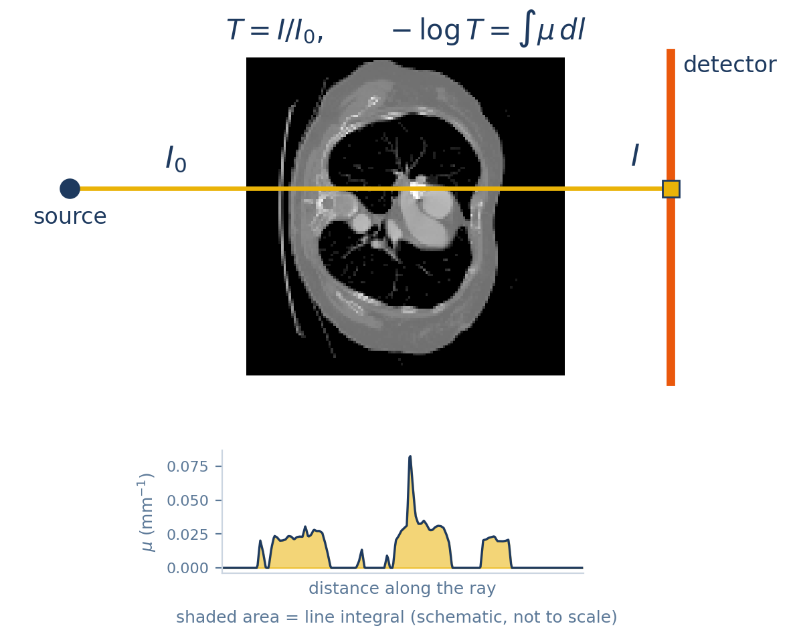
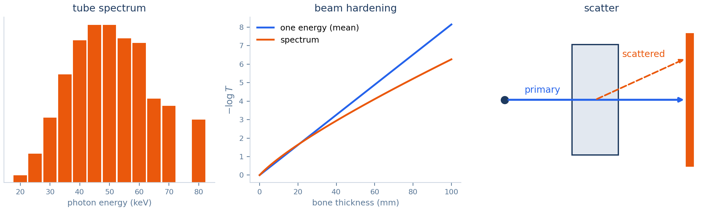
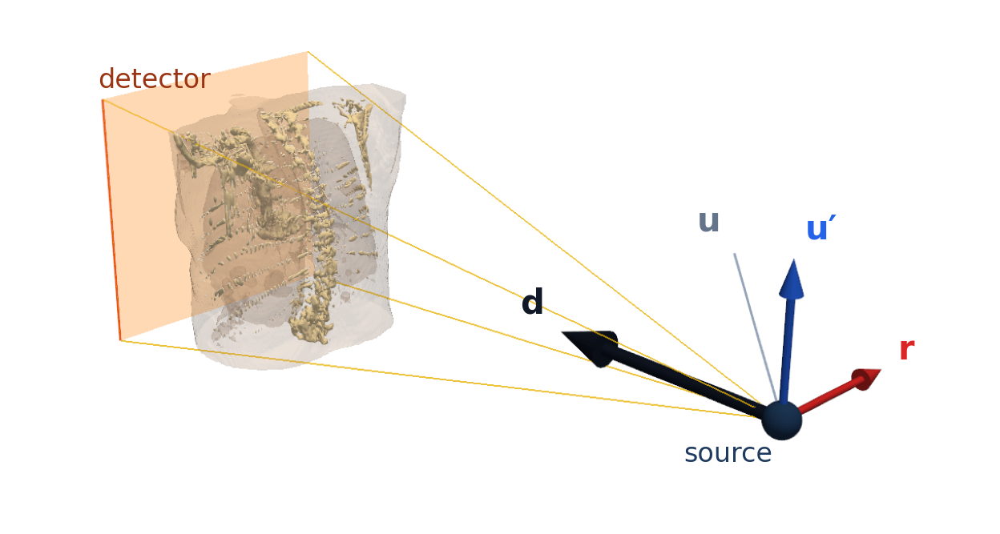
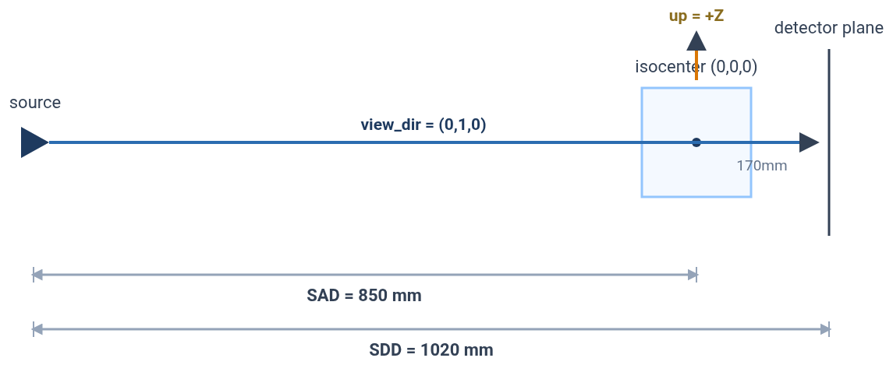
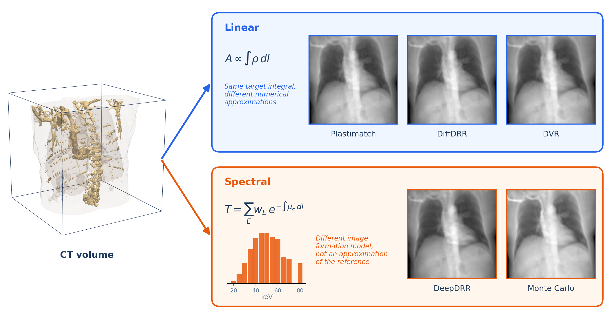
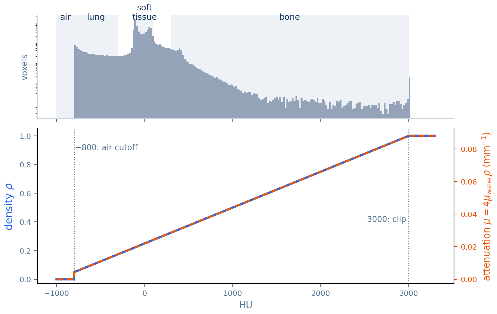
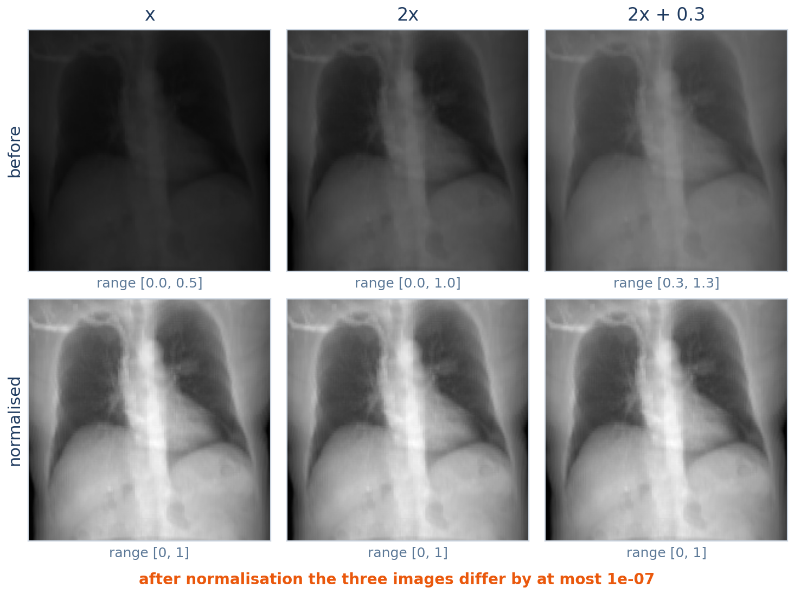
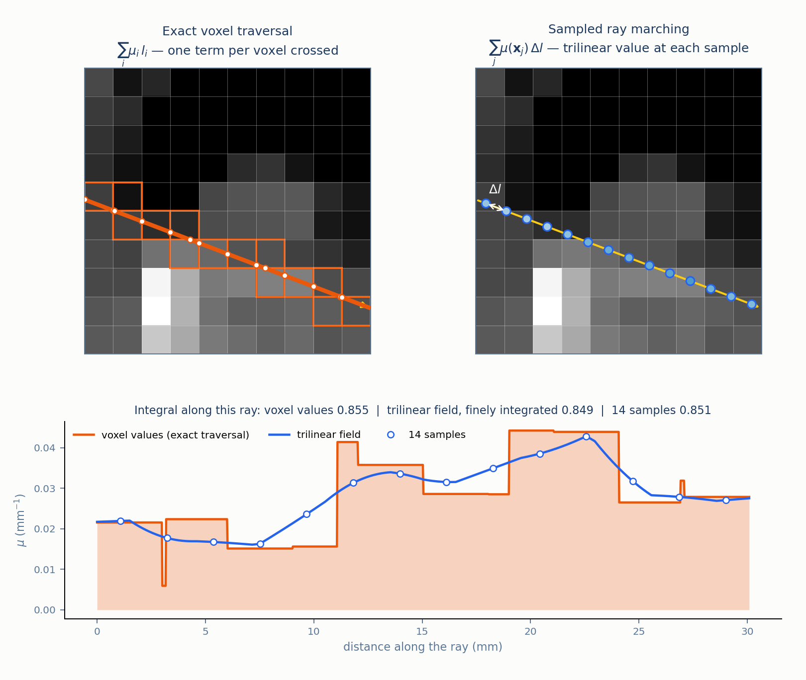
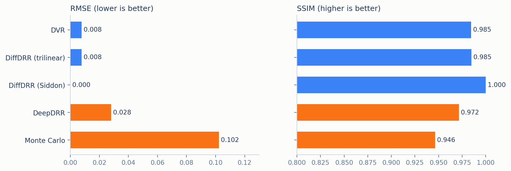
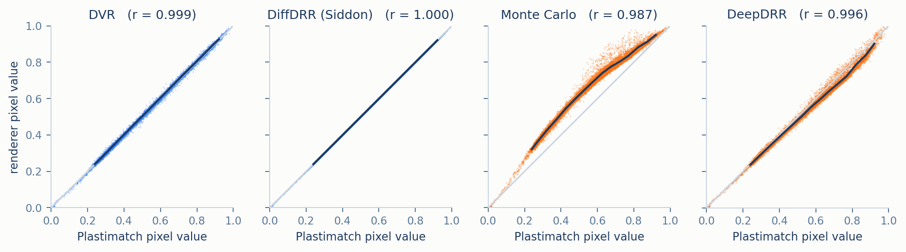

# Methodology

*(part of [Documentation Guide](INDEX.md))*

This document sets up everything the five per-renderer documents under [`methods/`](methods)
build on. It answers three questions in order. What physical quantity is a digitally
reconstructed radiograph (DRR) supposed to contain (§1)? How is the source, the detector, and
the volume placed so that all five renderers image the same scene (§2)? And, once every
renderer's output has gone through the same intensity normalisation the benchmark applies, which
renderers are actually computing the same thing and which are not (§3)? That last answer is the
thread that ties the rest of the documentation together: it is what explains the quality numbers
in [RESULTS.md](RESULTS.md). The exact parameter values, units and per-renderer settings are
collected in [CONVENTIONS.md](CONVENTIONS.md); this document explains the model behind them.
Throughout, the *benchmark reference* is Plastimatch: the exact solution of the single-energy
line-integral model, against which the other renderers are scored. It is a reference for this
comparison, not a measurement of a real patient. Implementation detail is otherwise out of scope;
§6 maps each concept to the code.

## Contents

1. [What a radiograph measures](#1-what-a-radiograph-measures)
2. [Imaging geometry](#2-imaging-geometry)
3. [Five renderers, two image formation models](#3-five-renderers-two-image-formation-models)
4. [The five methods at a glance](#4-the-five-methods-at-a-glance)
5. [What the measurements show](#5-what-the-measurements-show)
6. [Mapping to the code](#6-mapping-to-the-code)
7. [References](#7-references)
8. [Appendix: notation](#8-appendix-notation)

---

## 1. What a radiograph measures

An X-ray image records, for every detector pixel, how much of the beam leaving the source along
the straight line to that pixel survived the trip through the body. Tissue removes photons at a
rate set by its **linear attenuation coefficient** $`\mu`$ (units mm⁻¹): over a short distance
$`dl`$ a fraction $`\mu\,dl`$ of the beam is lost. Integrating that loss along the ray gives the
**Beer–Lambert law** for a beam of a single photon energy [1]:

```math
T = \frac{I}{I_0} = \exp\left(-\int_{\text{ray}} \mu(l)\, dl\right)
```

where $`I_0`$ is the intensity that would arrive with no object in the way and $`T`$ is the
**transmission**. In this benchmark, DRRs are represented in the attenuation domain rather than as
transmitted intensities, so that dense structures such as bone come out bright and air comes out
dark:

```math
-\log T = \int_{\text{ray}} \mu\, dl
```

The right-hand side, the **line integral** of $`\mu`$, is the quantity a DRR is built from.

<p align="center">
  
  <br><em>Figure 1. One detector pixel is one ray. The beam leaves with intensity I₀ and arrives with intensity I; the pixel value −log(I/I₀) is the area under the attenuation profile along the ray (schematic, not to scale).</em>
</p>

Two physical effects complicate it, and they are exactly the effects on which the five renderers
disagree:


- **A real tube emits a spectrum, not one energy.** $`\mu`$ depends on photon energy $`E`$, so
  the measured transmission is a spectrum-weighted average of many exponentials,
  $`T = \sum_E w_E \exp\left(-\int \mu_E\, dl\right)`$. Low-energy photons are removed faster,
  so the beam that survives deep into the body is "harder" than the one that entered. This
  **beam hardening** makes $`-\log T`$ grow more slowly than linearly with thickness — something
  no single-energy model can reproduce.
- **Some photons scatter instead of being absorbed.** Compton scattering deflects photons, and
  some of them still reach the detector from the wrong direction. They add a low-frequency haze
  on top of the sharp primary image and reduce contrast.

<p align="center">
  
  <br><em>Figure 2. The two effects behind the renderers' disagreement. Left: the tube spectrum of the Monte Carlo renderer. Middle: negative log transmission through bone, using the same attenuation tables; the spectrum bends below the straight single-energy line (beam hardening). Right: a scattered photon reaches the detector from the wrong direction.</em>
</p>

A renderer can therefore be described by three choices: how it evaluates the line integral
(exactly, or by sampling), whether it models a spectrum, and whether it models scatter. §3
returns to these three choices once the geometry the integral is evaluated in has been fixed.

## 2. Imaging geometry

Every renderer must place the same point source and the same flat detector around the same
volume, or their images cannot be compared pixel by pixel. This section states that placement in
the vocabulary of a pinhole camera: **extrinsics** say where the source sits and which way it
looks, **intrinsics** say how a ray direction maps to a detector pixel. Stating it this way is
useful because the real bugs this suite has had (§2.3) are exactly the mistakes a camera model
makes explicit. Every parameter named here is defined, with its default and units, in
[CONVENTIONS.md](CONVENTIONS.md) §1–§3.

### 2.1 Frames and conventions

Three configured quantities fix the geometry: the **view direction** $`\mathbf{d}`$ (from source
towards detector), the **up vector** $`\mathbf{u}`$ (the direction that should appear at the top
of the image), and the **isocenter** $`\mathbf{I}_w`$ (the world point the system is centred
on). From $`\mathbf{d}`$ and $`\mathbf{u}`$ every renderer builds the same right-handed,
orthonormal camera basis by a **look-at construction**:

```math
\mathbf{r} = \frac{\mathbf{d} \times \mathbf{u}}{\lVert \mathbf{d} \times \mathbf{u} \rVert},
\qquad
\mathbf{u}' = \mathbf{r} \times \mathbf{d}
```

The second step replaces $`\mathbf{u}`$ by $`\mathbf{u}'`$, the component of $`\mathbf{u}`$
perpendicular to the view direction. The configured up vector therefore only has to point
roughly upward. The defaults are $`\mathbf{d} = +Y`$ (an anterior–posterior, or AP, projection),
$`\mathbf{u} = +Z`$, and $`\mathbf{I}_w`$ at the world origin, which is also the centre of the
volume ([DATA.md](DATA.md) §2).

<p align="center">
  
  <br><em>Figure 3. The look-at basis. The configured up vector u (grey) only has to point roughly upward; u′ (blue) is its component perpendicular to d, and r completes the right-handed basis. The detector plane is perpendicular to d.</em>
</p>

| Frame | What it is |
|---|---|
| **World** | The volume's coordinate system, in millimetres, with the volume centred at the origin. |
| **Camera** | The basis $`(\mathbf{r}, \mathbf{u}', \mathbf{d})`$, with its origin at the source. |
| **Detector** | A plane perpendicular to $`\mathbf{d}`$; pixel columns run along $`\mathbf{r}`$, rows along $`-\mathbf{u}'`$. |

<p align="center">
  
  <br><em>Figure 4. Detector orientation for the default AP view: columns run to the right along +X, rows run downward along −Z, and pixel (0, 0) is the top-left corner. A mirrored image has the columns reversed; an upside-down one has the rows reversed.</em>
</p>

Two properties of this construction matter later.

**It degenerates when $`\mathbf{u}`$ is parallel to $`\mathbf{d}`$.** The cross product
vanishes and the in-plane rotation of the image is undefined. The multi-view sweep in
[RESULTS.md](RESULTS.md) §6 includes a cranial–caudal view that looks along the default up axis
(−Z). To keep its camera basis defined, that configuration uses +Y as its up vector instead. The
same kind of view exposed a bug in one third-party library (§2.3).

**Handedness is a per-library convention, not a physical fact.** Each renderer's own library
expects the camera basis in its own form — left- or right-handed, row- or column-vector,
millimetres or a normalised cube. What matters is that each conversion is done exactly once. A
correct conversion followed by a second "safety" flip is itself a mirror image (§2.3).

### 2.2 Extrinsics and intrinsics

**Extrinsics.** The source sits a source-to-axis distance $`\mathrm{SAD}`$ behind the isocenter,
and the detector centre sits on the same axis, a source-to-detector distance $`\mathrm{SDD}`$ from
the source:

```math
\mathbf{S} = \mathbf{I}_w - \mathrm{SAD}\cdot\mathbf{d},
\qquad
\mathbf{C}_{\text{det}} = \mathbf{I}_w + (\mathrm{SDD} - \mathrm{SAD})\cdot\mathbf{d}
```

With the defaults $`\mathrm{SAD} = 850`$ mm and $`\mathrm{SDD} = 1020`$ mm, the detector is
170 mm beyond the isocenter, not at it.

<p align="center">
  
  <br><em>Figure 5. Default imaging geometry. The source is 850&nbsp;mm from the isocenter; the detector is a further 170&nbsp;mm beyond it, 1020&nbsp;mm from the source. View direction +Y (AP), up +Z.</em>
</p>

**Intrinsics.** The benchmark uses a square detector of $`W \times W`$ pixels covering a physical square of side
$`L`$, where $`L`$ is the side length of the volume itself. Because rays fan out from a point,
an object at the isocenter is magnified by $`\mathrm{SDD}/\mathrm{SAD} = 1.2`$ on the detector, so
the detector sees an $`L\cdot\mathrm{SAD}/\mathrm{SDD} \approx 0.83\,L`$ wide slice of the volume
at the isocenter — 300 mm of the 360 mm example volume. In pinhole-camera terms, $`\mathrm{SDD}`$ plays the role of the focal length,
and the focal length measured in pixels is

```math
f_x = f_y = \frac{\mathrm{SDD}}{L/W}
```

Only renderers built on a general camera model need this number ([DVR](methods/dvr.md) §1).
The others construct each pixel's ray explicitly, from $`\mathbf{S}`$ to that pixel's position on
the detector plane.

Two details are easy to get backwards:

- **The detector is not at the isocenter.** A renderer that put it there would still produce a
  plausible image, only at the wrong magnification, which is why this kind of error does not show
  up by eye and has to be checked against the configured distances.
- **A detector normal is not a view direction.** One renderer's command-line interface asks for
  the detector's normal vector, which points back towards the source: it is $`-\mathbf{d}`$
  ([CONVENTIONS.md](CONVENTIONS.md) §7.1).

### 2.3 Why orientation is checked

A mirrored or upside-down image preserves the distribution of pixel intensities but changes their
spatial arrangement. Histograms and per-image statistics do not show it, and it looks plausible on
its own, although a spatially aligned comparison against a correctly oriented image does detect it.
A renderer that is right in one view can also be wrong in another. The suite therefore
compares every renderer against the benchmark reference in six views, not only the default one
([RESULTS.md](RESULTS.md) §6). Two real failures were found this way: an extra horizontal flip on top
of an already complete rotation matrix, which mirrored DiffDRR, and a third-party up-vector test that
fails for antiparallel vectors, which turned DeepDRR's PA view upside down. Both are described in
[DEVELOPMENT_NOTES.md](DEVELOPMENT_NOTES.md) §1.

With the shared source–detector geometry fixed, the renderers target corresponding detector rays,
though their integration bounds and numerical implementations may differ ([CONVENTIONS.md](CONVENTIONS.md)).
The next section asks what each of them computes along those rays.

## 3. Five renderers, two image formation models

Why can some renderers produce nearly identical DRRs, while others produce systematically different
intensities under the same imaging geometry? This section answers that question.

Three of the renderers compute the same density line integral and, under the shared geometry and encoding, differ in how they discretise it;
the other two compute a different, spectrum-dependent quantity. The equivalence of the first group
holds for the density encoding and the per-image normalisation described below. It is not an
unconditional physical equivalence.

Figure 6 previews the two families. It need not be fully understood yet: §3.1–3.2 first establish
why the single-energy renderers can be compared after normalisation, and §3.3 then explains why the
spectral renderers behave differently.

<p align="center">
  
  <br><em>Figure 6. The two image formation models, with each renderer's actual output on the example CT. Linear group (blue): different numerical implementations of the same target line integral of density, exact or sampled. Spectral group (orange): different image formation models, which weight transmission at each photon energy by a tube spectrum (Monte Carlo's 80 kVp spectrum shown) and, for Monte Carlo, add a scatter approximation. Their disagreement with the reference is therefore not necessarily numerical error, and a larger RMSE does not mean worse physics.</em>
</p>

### 3.1 What every renderer is given

Every renderer receives the same voxel grid of **normalised density** $`\rho \in [0,1]`$, encoded
from the scan's Hounsfield units (HU) — the CT scale on which air is −1000 and water is 0 — by a
fixed rule ([DATA.md](DATA.md) §1.2):

```math
\rho = \frac{\min(\mathrm{HU},\ 3000) + 1000}{4000} \ \text{ for } \mathrm{HU} > -800,
\qquad
\rho = 0 \ \text{ otherwise}
```

This $`\rho`$ is an encoding of HU, not a physical mass density. Renderers that need HU recover it
as $`4000\rho - 1000`$, which is exact for HU in $`(-800, 3000]`$. The standard calibration from HU to
attenuation is linear [1], and the benchmark reference applies it with one addition: everything at or
below −800 HU is treated as air, with zero attenuation ([Plastimatch](methods/plastimatch.md) §1).
The benchmark therefore defines attenuation directly from the stored density:

```math
\mu_{\text{benchmark}} = 4\,\mu_{\text{water}}\,\rho
```

For HU in $`(-800, 3000]`$ this equals the linear calibration
$`\mu_{\text{water}}\,(1 + \mathrm{HU}/1000)`$. At or below −800 HU the benchmark overrides the linear calibration (which would still give a small
positive value) and assigns zero attenuation, and above 3000 HU the encoding has clipped $`\rho`$ to 1, so the stored value, not the original HU, determines $`\mu`$.
This is the key observation, for the encoding this benchmark defines; it is not a general physical
identity. **Attenuation is proportional to the stored density**, and so is its line integral:

```math
\int \mu\, dl = 4\,\mu_{\text{water}} \int \rho\, dl
```

<p align="center">
  
  <br><em>Figure 7. From HU to density to attenuation on the example CT. Top: where the scan's voxels fall. Bottom: ρ is zero at or below −800 HU, rises linearly to 1 at 3000 HU and stays there; μ = 4μ_water ρ is the same curve on a different scale.</em>
</p>

A worked example: water, HU = 0, is stored as $`\rho = (0+1000)/4000 = 0.25`$, so
$`\mu = 4 \times 0.022 \times 0.25 = 0.022\ \text{mm}^{-1}`$, which is $`\mu_{\text{water}}`$ as it
should be. A 100 mm path through water then gives $`\int\mu\,dl = 2.2`$ and a transmission of
$`e^{-2.2} \approx 0.11`$. Changing $`\mu_{\text{water}}`$ multiplies every $`\int\mu\,dl`$ by the same
positive constant, which is exactly what §3.2 removes.

### 3.2 Normalisation removes scale

Before any two images are compared, the benchmark rescales each one to the range $`[0,1]`$:

```math
\tilde{x} = \frac{x - \min x}{\max x - \min x}
```

In exact arithmetic, any renderer whose output is a positive affine transformation $`a\,x + b`$,
$`a > 0`$, of the same density line integral produces the same normalised image, whatever value of
$`\mu_{\text{water}}`$ it assumes, whether it converts to HU at all, and whatever units it measures
length in. The implementation adds $`10^{-8}`$ to the denominator, so that a constant image maps to
zero instead of dividing by zero; with that epsilon the equivalence is approximate in practice, and
negligible for images whose range is of order 1.

Remaining differences between such renderers can arise from the density field they represent,
their integration bounds, the accuracy of their numerical integration, renderer-specific geometric
conventions, and whether the proportionality factor is truly the same for every pixel.

<p align="center">
  
  <br><em>Figure 8. Why scale and offset do not matter (a synthetic demonstration, not a benchmark result). The same render multiplied by 2, and by 2 with 0.3 added, look different before normalisation (top) and identical after it (bottom).</em>
</p>

**Key implication.** The shared encoding makes $`\mu \propto \rho`$ (§3.1), so the benchmark
reference's $`\int \mu\, dl`$ is a positive multiple of $`\int \rho\, dl`$. Min–max normalisation removes
that multiple (§3.2). Any renderer that returns an affine function of $`\int \rho\, dl`$ with a
positive slope therefore produces a comparable image, and its remaining difference is how well it
evaluates the integral. A spectral renderer returns the logarithm of a weighted sum of exponentials,
which is not an affine function of $`\int \rho\, dl`$ in general, so normalisation cannot make it
comparable in the same way.

### 3.3 Which side of the line each renderer falls on

This splits the five renderers into two groups. The first group evaluates the line integral of §1 in
one of two ways, shown in Figure 9: exactly, as a sum of ray-in-voxel lengths, or approximately, as
a sum over sample points.

<p align="center">
  
  <br><em>Figure 9. Two ways to evaluate the same line integral on one ray through a 10×10-voxel patch of the example CT. Top left: exact traversal, one term per voxel crossed (Plastimatch, DiffDRR Siddon). Top right: sampling at evenly spaced points with trilinear interpolation (DVR, DiffDRR trilinear). Bottom: μ along the ray. Two effects separate the sampled result from the exact one: interpolation replaces the stepwise voxel values with a smooth field (voxel values 0.855, interpolated field integrated finely 0.849), and a finite number of samples approximates the integral of that field (14 samples, 0.851).</em>
</p>

The two methods differ both in the representation of the density field (piecewise constant for
exact traversal, trilinearly interpolated for sampling) and in how the integral is evaluated (exact
traversal, numerical quadrature).

**Linear in $`\int \rho\, dl`$ — the same quantity, discretised differently.**

- [Plastimatch](methods/plastimatch.md) evaluates $`\int \mu\, dl`$ exactly, with Siddon's
  algorithm [2], which computes the exact length of the ray inside every voxel it crosses. It is
  the benchmark reference.
- [DiffDRR](methods/diffdrr.md) evaluates $`\int \rho\, dl`$ with the same exact algorithm,
  written so that the result can be differentiated with respect to the camera pose. Its
  alternative "trilinear" mode samples 500 evenly spaced points per ray and sums them.
- [DVR](methods/dvr.md) is built on a graphics volume renderer, but its raymarcher computes the
  plain sum of interpolated density times step length along each ray — the same Riemann sum as
  DiffDRR's trilinear mode.

**Non-linear in $`\int \rho\, dl`$ — a different quantity.**

- [Monte Carlo](methods/monte_carlo.md) models a 12-bin spectrum, blends tissue and bone
  attenuation according to local density, and adds a blurred scatter term. The result is
  $`-\log\left(\sum_E w_E e^{-\int \mu_E dl} + S\right)`$, which no affine rescaling can turn
  into $`\int \rho\, dl`$.
- [DeepDRR](methods/deepdrr.md) also models a spectrum, with separate energy-dependent
  coefficients for air, soft tissue and bone, so it too is the logarithm of a weighted sum of
  exponentials, and its value depends on how a ray's matter splits between tissue and bone, not
  only on the total.

Under the shared geometry, the shared density encoding and the per-image normalisation, the first
group differs only in how the integral is evaluated (exactly, or by sampling), so it should agree
closely with the benchmark reference, pixel by pixel. The second group models physics the benchmark reference does not, so its pixel
values should not match, even where its anatomy does. §5 checks both predictions.

## 4. The five methods at a glance

| Method | Line integral | Samples per ray (central ray, default settings) | Spectrum | Scatter |
|---|---|---|---|---|
| [Plastimatch](methods/plastimatch.md) | exact (Siddon) | one segment per voxel crossed, about 125 | single energy | none |
| [DiffDRR](methods/diffdrr.md), Siddon | exact (Siddon), differentiable | one segment per voxel crossed, about 125 | single energy | none |
| [DiffDRR](methods/diffdrr.md), trilinear | sampled, trilinear interpolation | 500 from volume entry to the detector | single energy | none |
| [DVR](methods/dvr.md) | sampled, trilinear interpolation | about 160 of 320 inside the volume | single energy | none |
| [Monte Carlo](methods/monte_carlo.md) | sampled, trilinear interpolation | 128 from volume entry to the detector | 12 bins, 20–80 keV | Gaussian-blur approximation |
| [DeepDRR](methods/deepdrr.md) | sampled, trilinear, 0.1 mm steps | about 3600 inside the volume | library default, 90 kVp | none (disabled in the installed version) |

Sample counts are for the benchmark's default volume, a $`128^3`$ grid 360 mm on a side with
2.8 mm voxels ([DATA.md](DATA.md) §1.3). "Single energy" means the method has no spectrum: it
integrates one attenuation (or density) field. [CONVENTIONS.md](CONVENTIONS.md) §6 lists the
parameter that controls each count.

## 5. What the measurements show

<p align="center">
  
  <br><em>Figure 10. RMSE and SSIM against the Plastimatch benchmark reference (200×200, AP view). Blue: renderers linear in the density line integral (§3.3). Orange: renderers that model a spectrum.</em>
</p>

Both predictions of §3.3 hold, on both metrics.

**The linear group computes the benchmark reference's quantity.** DiffDRR's exact mode, which runs the
benchmark reference's own algorithm on the same voxel grid, reproduces Plastimatch to floating-point
precision: root-mean-square error (RMSE) below $`10^{-6}`$, structural similarity (SSIM) [4]
1.000. DVR and DiffDRR's trilinear mode, which compute the same trilinear Riemann sum through two
unrelated implementations, agree with each other to three decimals, at RMSE 0.008 and SSIM 0.985
against the benchmark reference. Their remaining error is consistent with the smoothing trilinear interpolation applies
at sharp edges, though sample spacing, the ray's extent inside the volume and the quadrature itself also contribute, and this suite does not separate them.

**The non-linear group does not.** DeepDRR's RMSE is 0.028, nearly four times the sampled linear
renderers', and Monte Carlo's 0.102, more than ten times. The two metrics weigh this differently:
RMSE counts every difference in pixel value, while SSIM compares local structure and is far less
sensitive to a smooth change of overall brightness. In these renders, Monte Carlo's departure looks mostly like such a smooth
change (an observation, not a causal analysis), so its SSIM of 0.946 is much closer to the others than its RMSE.

The per-pixel difference maps of [RESULTS.md](RESULTS.md) §4 show where in the image the errors fall.
Plotting every pixel of a renderer's image against the same pixel of the benchmark reference shows
how the values differ. If a renderer computes an affine function of the same line integral, the
points fall on the diagonal; if it computes something else, they do not.

<p align="center">
  
  <br><em>Figure 11. Every pixel of four 200×200 renders plotted against the same pixel of the Plastimatch render, with the median in each band of benchmark-reference values drawn as a line (only for bands holding at least 400 pixels; the few darker pixels are background at the image edges). DiffDRR lies exactly on the diagonal and DVR within a narrow band around it. Monte Carlo follows a smooth concave curve: its mid-range pixels are brighter than the reference's. DeepDRR follows the diagonal on average with a wider spread, consistent with its value depending on each ray's mix of tissue and bone.</em>
</p>

These observations characterise agreement with the chosen benchmark reference, a single-energy
model, not the physical accuracy of each renderer: DeepDRR and Monte Carlo model a spectrum the
reference does not.

The two non-linear renderers depart from the diagonal in different ways, and neither by
misalignment: Monte Carlo through one smooth intensity function, DeepDRR through a per-ray
dependence on how much matter, and of which kind, the ray crosses. Both reflect physics the benchmark
reference does not model; the scatter plots show that the pixel values differ, while the physical
cause of each difference comes from the model of §3.3, not from the plots alone.

## 6. Mapping to the code

| Concept | Where it lives |
|---|---|
| §2 shared geometry ($`\mathrm{SDD}`$, $`\mathrm{SAD}`$, isocenter, view and up vectors) | `GeometryConfig`, `DEFAULT_GEOMETRY` (`src/drr/renderers/config.py`) |
| §3.1 density encoding | `hu_to_density`, `density_to_hu`, `load_ct_volume` (`src/drr/data.py`) |
| §3.2 min–max normalisation before comparison | `compute_metrics` (`src/drr/utils/metrics.py`) |
| §4 per-renderer entry points | `build_dvr_renderer`, `build_diffdrr_renderer`, `generate_plastimatch_drr`, `generate_mc_drr`, `generate_deepdrr_drr`, re-exported from `src/drr/renderers/__init__.py` |
| §5 quality, registration, multi-view and sweep benchmarks | `src/drr/benchmarks.py`, driven by `scripts/run_benchmark.py` |

## 7. References

1. J.T. Bushberg, J.A. Seibert, E.M. Leidholdt, J.M. Boone. *The Essential Physics of Medical
   Imaging*, 4th ed. Wolters Kluwer. (Beer–Lambert law, Hounsfield units, beam hardening,
   scatter.)
2. R.L. Siddon. Fast calculation of the exact radiological path for a three-dimensional CT array.
   *Medical Physics* 12(2), 1985.
3. N. Max. Optical models for direct volume rendering. *IEEE Transactions on Visualization and
   Computer Graphics* 1(2), 1995.
4. Z. Wang, A.C. Bovik, H.R. Sheikh, E.P. Simoncelli. Image quality assessment: from error
   visibility to structural similarity. *IEEE Transactions on Image Processing* 13(4), 2004.
5. N. Ravi et al. Accelerating 3D Deep Learning with PyTorch3D. *arXiv:2007.08501*, 2020.
6. V. Gopalakrishnan, P. Golland. Fast auto-differentiable digitally reconstructed radiographs for
   solving inverse problems in intraoperative imaging. *Workshop on Clinical Image-Based
   Procedures*, Springer, 2022.
7. M. Unberath et al. DeepDRR: A Catalyst for Machine Learning in Fluoroscopy-guided Procedures.
   *MICCAI*, 2018.
8. J.H. Hubbell, S.M. Seltzer. Tables of X-Ray Mass Attenuation Coefficients and Mass
   Energy-Absorption Coefficients. *NIST Standard Reference Database 126*, National Institute of
   Standards and Technology.

## 8. Appendix: notation

Symbols shared by every document in this suite:

| Symbol | Meaning | Units |
|---|---|---|
| $`\rho`$ | Normalised density stored per voxel | none, $`[0,1]`$ |
| HU | Hounsfield units; recovered as $`4000\rho - 1000`$ only for HU in $`(-800, 3000]`$ | none; air −1000, water 0 |
| $`\mu`$ | Linear attenuation coefficient | mm⁻¹ (cm⁻¹ where stated) |
| $`l`$, $`l_i`$ | Distance along a ray; length of the ray inside voxel $`i`$ | mm |
| $`T`$ | Transmission, the surviving fraction of the beam | none, $`[0,1]`$ |
| $`w_E`$ | Weight of energy bin $`E`$ in a spectrum, $`\sum_E w_E = 1`$ | none |
| $`N`$ | Number of samples per ray in a sampled renderer | none |
| $`\mathbf{d}`$, $`\mathbf{u}`$, $`\mathbf{r}`$ | View, up and right vectors of the camera basis (§2.1) | unit vectors |
| $`\mathrm{SAD}`$, $`\mathrm{SDD}`$ | Source-to-isocenter and source-to-detector distances (§2.2) | mm |
| $`L`$ | Side length of the volume, and of the detector | mm |
| ZNCC | Zero-mean normalised cross-correlation, the registration similarity | none, $`[-1,1]`$ |

Two local reuses: [Plastimatch](methods/plastimatch.md) uses $`\alpha`$ for the position along a
ray, and [DVR](methods/dvr.md) uses $`\alpha_k`$ for a sample's opacity. Each document defines
its use where it first appears.
