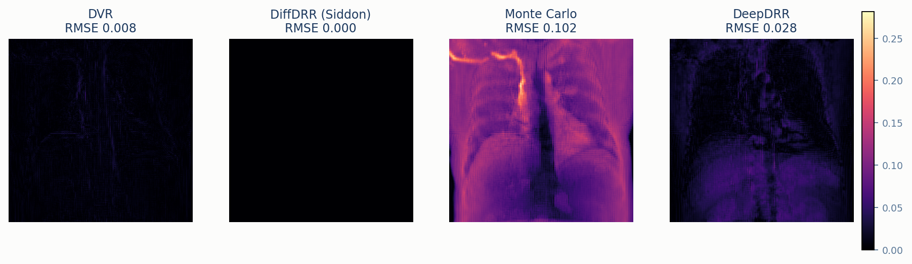
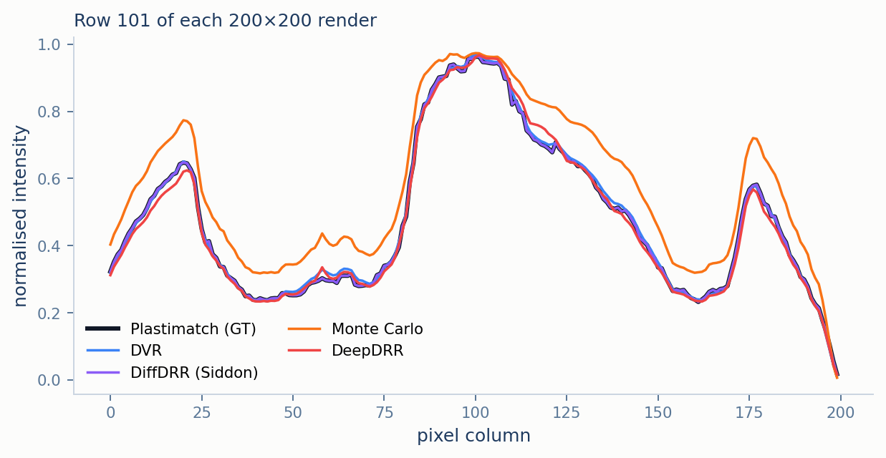
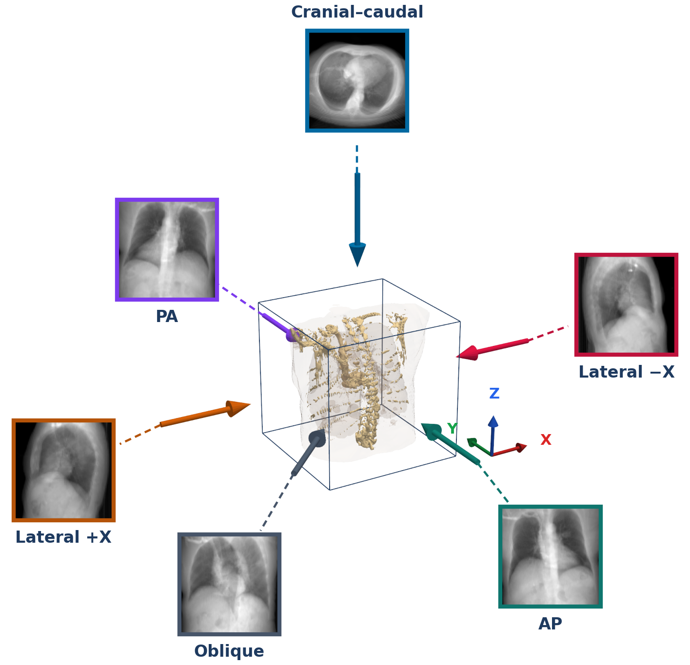

# Experimental Results

*(part of [Documentation Guide](INDEX.md))*

This document reports what the five renderers do when measured: how fast they are (§2), how much
GPU memory they need (§3), how close their images are to the benchmark reference (§4), how well the two
differentiable ones recover a camera pose (§5), whether their agreement holds beyond one view
(§6), and how quality changes with resolution and sample count (§7). Each section interprets its
numbers against the theory in [METHODOLOGY.md](METHODOLOGY.md) and [`methods/`](methods),
especially the split of [METHODOLOGY.md](METHODOLOGY.md) §3.3 between renderers that compute the
same density line integral as the benchmark reference and renderers that model a spectrum. A short final
section (§8) points to the development notes on the bugs found while building the benchmark. For installing and running the benchmark, see [`README.md`](../README.md).

## Contents

1. [Setup](#1-setup)
2. [Rendering speed](#2-rendering-speed)
3. [Memory footprint](#3-memory-footprint)
4. [Image quality against benchmark reference](#4-image-quality-against-benchmark-reference)
5. [2D/3D registration](#5-2d3d-registration)
6. [Multi-view consistency](#6-multi-view-consistency)
7. [Resolution and sampling sweeps](#7-resolution-and-sampling-sweeps)
8. [Development notes](#8-development-notes)
9. [Scope and limitations](#9-scope-and-limitations)

---

## 1. Setup

All results use the example chest CT, resampled to a $`128^3`$ cube 360 mm on a side with 2.8 mm
voxels ([DATA.md](DATA.md) §1), and the default geometry of [CONVENTIONS.md](CONVENTIONS.md) §1:
an AP view, $`\mathrm{SAD} = 850`$ mm, $`\mathrm{SDD} = 1020`$ mm. Before any two images are
compared, each is rescaled to $`[0,1]`$ by its own minimum and maximum
([METHODOLOGY.md](METHODOLOGY.md) §3.2). The numbers come from

```bash
python scripts/run_benchmark.py --resolutions 128 256 512 1024 --quality-resolutions 128 256 512 1024
```

- **GPU:** NVIDIA TITAN RTX (24 GB), driver 580.17, CUDA 12.4
- **Software:** PyTorch 2.6.0+cu124, PyTorch3D 0.7.9 (built from source), DiffDRR 0.6.1, DeepDRR
  1.2.2, Plastimatch 1.10.0 (installed as a snap; see [`README.md`](../README.md))

## 2. Rendering speed

Only the three GPU renderers are timed; Plastimatch and Monte Carlo run on the CPU and serve as
references. Each value is the mean ± standard deviation of 20 renders after 5 warm-up renders.

| Resolution | DVR | DiffDRR (Siddon) | DeepDRR |
|---|---|---|---|
| 128×128 | 6.6 ± 0.5 ms | 5.6 ± 0.2 ms | 80.3 ± 8.9 ms |
| 256×256 | 11.7 ± 0.8 ms | 16.9 ± 0.3 ms | 94.6 ± 12.2 ms |
| 512×512 | 32.1 ± 0.6 ms | 68.6 ± 1.2 ms | 137.7 ± 10.3 ms |
| 1024×1024 | 135.1 ± 5.2 ms | 291.4 ± 3.6 ms | 464.4 ± 88.4 ms |

<p align="center">
  
  <br><em>Figure 1. Mean render time per frame, by resolution.</em>
</p>

DiffDRR is fastest at 128×128; DVR is faster from 256×256 up, and about twice as fast at
1024×1024. Per ray, DVR takes 320 samples, about 160 inside the volume, while DiffDRR's exact mode
takes one step per voxel crossed, about 125 on the central ray; above 256×256 it renders in patches to
bound its memory (§3).

DeepDRR is slower than both at every size, by a factor of 3–14. It marches each ray in 0.1 mm
steps, about 3600 on the central ray, reading interpolated density and three material labels at
each ([DeepDRR](methods/deepdrr.md) §2), and it rebuilds its material segmentation on every call,
a fixed cost that dominates at small sizes.

## 3. Memory footprint

Peak GPU memory, in MB:

| Resolution | DVR fwd | DVR fwd+bwd | DiffDRR fwd | DiffDRR fwd+bwd | DeepDRR fwd |
|---|---|---|---|---|---|
| 128×128 | 249.0 | 396.8 | 395.7 | 637.8 | 80.8 |
| 256×256 | 747.9 | 1186.4 | 1344.0 | 2313.7 | 82.1 |
| 512×512 | 2680.5 | 4312.6 | 1161.8 | 3983.5 | 88.3 |
| 1024×1024 | 10402.3 | 16818.3 | 1212.4 | 14528.2 | 108.4 |

<p align="center">
  
  <br><em>Figure 2. Peak GPU memory by resolution. Forward pass only for DeepDRR, which is not differentiable; forward and forward-plus-backward for the two differentiable renderers.</em>
</p>

DVR's memory grows with the number of pixels times the number of samples, since every sample of
every ray is held at once: roughly fourfold per doubling of resolution. DiffDRR's forward memory
stops growing above 256×256, because from there it renders 256×256 patches one at a time; its
backward pass still grows, but stays below DVR's ([DEVELOPMENT_NOTES.md](DEVELOPMENT_NOTES.md) explains why patching was needed).

DeepDRR's figures are a lower bound and are not comparable with the other columns. It allocates GPU
memory through CuPy, a separate library whose allocations PyTorch's memory counters do not see, so
the table shows only the part PyTorch can observe, not DeepDRR's total peak memory.

## 4. Image quality against benchmark reference

Each renderer's 200×200 AP render is compared with Plastimatch's using root-mean-square error
(RMSE), peak signal-to-noise ratio (PSNR) and structural similarity (SSIM) [1]. RMSE and PSNR
compare pixel values directly; SSIM compares local means, contrasts and correlations in small
windows, and so responds to edges and texture more than to overall brightness.

| Method | RMSE | PSNR (dB) | SSIM |
|---|---|---|---|
| DiffDRR (Siddon) | 0.0000 | 119.3 | 1.0000 |
| DVR | 0.0077 | 42.29 | 0.9846 |
| DiffDRR (trilinear) | 0.0077 | 42.31 | 0.9847 |
| DeepDRR | 0.0281 | 31.03 | 0.9716 |
| Monte Carlo | 0.1022 | 19.81 | 0.9464 |

<p align="center">
  
  <br><em>Figure 3. All renderers on the same volume and geometry (200×200, AP view).</em>
</p>

The table follows the prediction of [METHODOLOGY.md](METHODOLOGY.md) §3.3 on every metric.

**DiffDRR's exact mode reproduces the benchmark reference.** It runs the same algorithm as Plastimatch on
the same voxel grid, and the two images agree to floating-point precision: RMSE below $`10^{-6}`$,
PSNR 119 dB (for images scaled to $`[0,1]`$, the $`10^{-12}`$ floor the metric adds to the error caps PSNR at about 120 dB). On this CT and these views, that is strong evidence that both place every voxel, pixel and ray
consistently; it is a measured result, not a guarantee for every input.

**The sampled linear renderers approximate the same integral by trilinear sampling.** DVR and
DiffDRR's trilinear mode compute the same trilinear Riemann sum through two unrelated
implementations and agree with each other to three decimals on all three metrics. Their remaining error against the exact integral,
RMSE 0.008, is consistent with the smoothing that trilinear interpolation introduces at sharp edges
(Figure 4 shows the errors lying on edges), though sample spacing and ray extent also contribute and
are not separated here.

**The spectral renderers differ by design.** DeepDRR and Monte Carlo model a tube spectrum, and
Monte Carlo also scatter, so their pixel values are a different function of the anatomy: RMSE 0.028
and 0.102.

<p align="center">
  
  <br><em>Figure 4. Absolute difference from Plastimatch, per pixel, on one colour scale. DiffDRR's is zero everywhere. DVR's is small and lies on sharp edges. DeepDRR's is larger, highest across the abdomen below the diaphragm and along the spine. Monte Carlo's is largest: a smooth offset over the whole body, highest along the clavicle and spine.</em>
</p>

<p align="center">
  
  <br><em>Figure 5. One image row crossing both lungs and the mediastinum, read from all five renders. DVR, DiffDRR and DeepDRR are almost indistinguishable from Plastimatch. Monte Carlo matches it at the brightest point but sits 0.05–0.15 above it in the lungs and at the sides of the body, while every edge stays in the same column.</em>
</p>

Monte Carlo exhibits a smooth, systematic brightening of everything but the densest regions
(Figures 4 and 5). This may reflect the combined effects of its polychromatic spectrum, its
heuristic density-to-attenuation mapping and its approximate scatter model; the current experiments
do not isolate the contribution of each. RMSE counts the difference in full; SSIM, which looks at local structure, penalises it much less, which is why
Monte Carlo's SSIM of 0.946 is far closer to the others than its RMSE. DeepDRR's error is largest
where rays cross the most matter — the abdomen below the diaphragm, and the spine — which is where
a polychromatic, material-dependent attenuation departs furthest from a single-energy line
integral ([DeepDRR](methods/deepdrr.md) §4).

## 5. 2D/3D registration

Both differentiable renderers are given the same task ([DiffDRR](methods/diffdrr.md) §3): starting
from a pose rotated 15° about the $`X`$ axis, recover the pose of a target image rendered by the
same renderer, using Adam with learning rate $`10^{-2}`$ on the negative ZNCC loss, at 150×150. The
run stops when ZNCC reaches 0.9995, or after 300 iterations, and the remaining pose error is
measured against the known target pose.

| Method | Iterations to ZNCC 0.9995 | Time | Final ZNCC | Rotation error | Source-position error |
|---|---|---|---|---|---|
| DVR | 29 | 0.56 s | 0.9996 | 0.18° | 2.9 mm |
| DiffDRR | 29 | 0.44 s | 0.9995 | 0.20° | 3.0 mm |

<p align="center">
  
  <br><em>Figure 6. Negative ZNCC per iteration for both renderers, until the stopping threshold.</em>
</p>

Both renderers reduce a 15° error to about 0.2° in the same number of iterations; DiffDRR's lower
time per iteration at this size makes it faster overall. The stopping threshold matters more than
it looks. ZNCC is so flat near the target that it already reaches 0.99 — the benchmark's original
threshold — about 5° away ([DiffDRR](methods/diffdrr.md) Figure 4); DiffDRR's run stopped there
after 19 iterations with 4.5° still left ([DEVELOPMENT_NOTES.md](DEVELOPMENT_NOTES.md)). The current threshold was chosen by recording
pose error against ZNCC during descent.

The two renderers also parameterise the rotation differently: DiffDRR optimises three Euler angles,
DVR an axis-angle offset on the starting rotation. Both keep the rotation a proper rotation. The
comparison is between two complete registration setups, not between two renderers alone, and in
both the target is rendered by the same renderer, which makes this the easiest form of the
problem.

## 6. Multi-view consistency

A renderer that agrees with the benchmark reference on one view has not been shown to agree on others;
two of the bugs in [DEVELOPMENT_NOTES.md](DEVELOPMENT_NOTES.md) appeared only away from the default AP view. This sweep renders every method
from six views: AP, PA (the reverse), both laterals, an oblique view with the isocenter moved off
the volume centre, and a cranial–caudal view that looks along the default up axis. That configuration uses +Y as its
up vector so that the camera basis of [METHODOLOGY.md](METHODOLOGY.md) §2.1 stays defined; the
view is included because it exposed an orientation bug in DeepDRR.

<p align="center">
  
  <br><em>Figure 7. The six views, drawn from the configurations in the benchmark. Each arrow is the view direction d into the volume; each image is Plastimatch's render from that view. The cranial–caudal view looks along −Z, parallel to the default up axis, so its up vector is +Y. The oblique view's isocenter offset, (5, 5, 0) mm, is not shown.</em>
</p>

<p align="center">
  
  <br><em>Figure 8. All five renderers across the six views.</em>
</p>

SSIM against Plastimatch for each view:

| View | Monte Carlo | DVR | DiffDRR (Siddon) | DeepDRR |
|---|---|---|---|---|
| AP | 0.946 | 0.985 | 1.000 | 0.972 |
| PA | 0.951 | 0.985 | 1.000 | 0.972 |
| Lateral +X | 0.906 | 0.990 | 1.000 | 0.979 |
| Lateral −X | 0.944 | 0.987 | 1.000 | 0.972 |
| Oblique + isocenter offset | 0.959 | 0.993 | 1.000 | 0.975 |
| Cranial–caudal (along the up axis) | 0.904 | 0.987 | 1.000 | 0.982 |

DiffDRR's exact mode matches the benchmark reference in every view, including the cranial–caudal view, and
DVR stays at 0.985 or above: the geometry of the linear renderers agrees with the reference in all six views.
DeepDRR stays between 0.97 and 0.98. Monte Carlo varies most, from 0.90 to 0.96; Figure 8 shows
the same silhouette, position and orientation in every one of its columns, suggesting that the
variation is primarily in intensity; subtle geometric differences are not independently quantified here. Its two lowest views, the +X lateral and the cranial–caudal, are not the
two in which rays cross the most matter — the opposite lateral crosses the same matter and scores
0.944 — so this benchmark does not identify what drives the difference. The cranial–caudal view is
not clinically realistic; it is here to exercise an unusual view orientation, and it did expose a bug
([DEVELOPMENT_NOTES.md](DEVELOPMENT_NOTES.md)).

## 7. Resolution and sampling sweeps

**Quality against resolution.** §4 uses a single 200×200 render. This sweep repeats the
comparison from 128 to 1024 pixels.

<p align="center">
  
  <br><em>Figure 9. SSIM against Plastimatch by output resolution.</em>
</p>

| Resolution | Monte Carlo | DVR | DiffDRR (Siddon) | DeepDRR |
|---|---|---|---|---|
| 128×128 | 0.947 | 0.990 | 1.000 | 0.976 |
| 256×256 | 0.947 | 0.981 | 1.000 | 0.969 |
| 512×512 | 0.944 | 0.972 | 1.000 | 0.965 |
| 1024×1024 | 0.945 | 0.969 | 1.000 | 0.965 |

DiffDRR matches the benchmark reference at every resolution. DVR and DeepDRR fall slowly as resolution
rises: at 1024×1024 a detector pixel is 0.35 mm, an eighth of a voxel. A plausible explanation is that the smoothing their trilinear interpolation
applies to each voxel's edges then spans several pixels, where an exact integrator draws a sharp
step; this sweep does not isolate that cause. Monte Carlo is flat across resolutions, because its scatter blur is
specified in millimetres ([Monte Carlo](methods/monte_carlo.md) §5).

**DVR's sample count.** This sweep varies DVR's samples per ray, $`N`$, at 200×200
([DVR](methods/dvr.md) §2 and §4). DiffDRR is not included: its exact mode has no sample count,
and its sampled mode's count stays at its default of 500 throughout the benchmark.

<p align="center">
  
  <br><em>Figure 10. DVR's SSIM against Plastimatch, and its render time, by sample count N.</em>
</p>

SSIM rises from 0.61 at $`N = 16`$ to 0.979 at $`N = 128`$ and reaches 0.985 at $`N = 256`$, after
which nothing changes; render time keeps rising. At $`N = 256`$ about 128 samples fall inside the
volume, one per voxel; beyond that, extra samples add nothing. The default of $`N = 320`$ is just
past that point.

## 8. Development notes

Fixing the bugs found while building the benchmark changed several of the numbers above. Their
history, causes and fixes are recorded separately in [DEVELOPMENT_NOTES.md](DEVELOPMENT_NOTES.md).

## 9. Scope and limitations

The numbers in this document describe the experiments as run, and no more:

- **One CT volume.** Every result uses the same example chest CT, resampled to $`128^3`$. Other
  anatomy, resolutions or scanners may rank the renderers differently.
- **Agreement with a computational reference.** Image-quality metrics measure how closely each
  renderer matches Plastimatch, the exact solution of a single-energy line-integral model. They do
  not measure clinical realism: a renderer that models a tube spectrum can be more realistic and
  still score worse.
- **Self-registration.** Each registration target is rendered by the same renderer from the same
  volume, from one starting error about one axis. The results do not represent registration against
  real radiographs.
- **Mechanisms are not isolated.** Where this document offers an explanation for a difference, for
  example for Monte Carlo's intensity offset, the experiments do not separate the candidate causes.
- **One machine.** Timings and memory come from one GPU and software stack
  ([INSTALLATION.md](INSTALLATION.md) §2).

## References

1. Z. Wang, A.C. Bovik, H.R. Sheikh, E.P. Simoncelli. Image quality assessment: from error
   visibility to structural similarity. *IEEE Transactions on Image Processing* 13(4), 2004.
