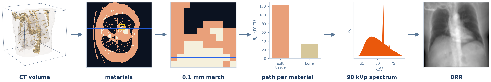
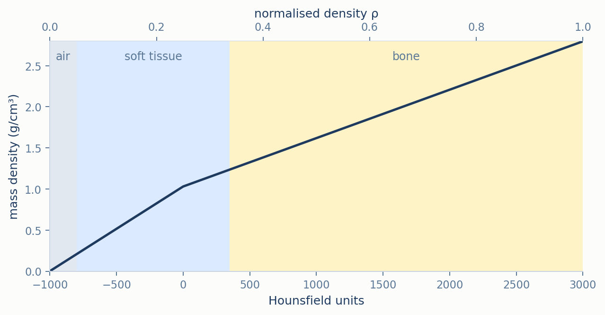
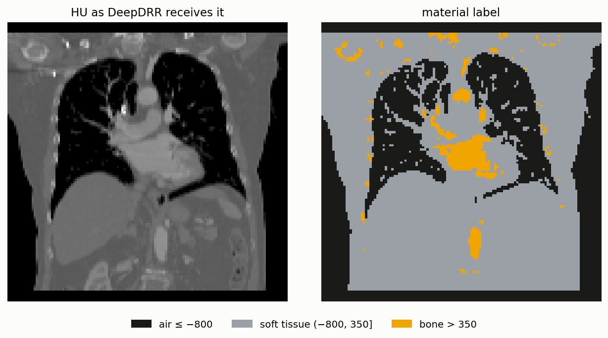
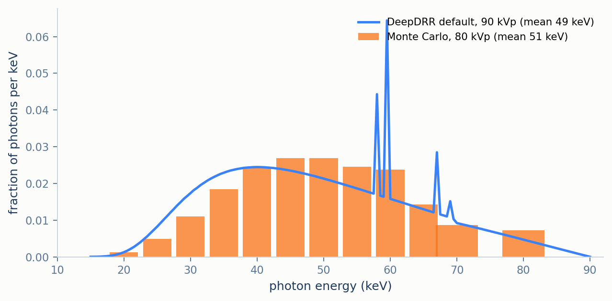

# DeepDRR: Polychromatic Ray Marching Through Segmented Materials

*(part of [Methodology](../METHODOLOGY.md))*

DeepDRR [1, 2] is the most physically detailed renderer in this suite. It converts each voxel to a
real mass density and a material label, marches every ray in very fine steps, and combines the
result over a full X-ray tube spectrum with energy-dependent attenuation for each material. As
installed here it has no scatter. Its output is the logarithm of a weighted sum of exponentials,
which places it in the *non-linear* group of [METHODOLOGY.md](../METHODOLOGY.md) §3.3: it is not
expected to match the single-energy benchmark reference exactly, and this document shows where and
why it differs.

<p align="center">
  
  <br><em>Figure 1. DeepDRR's pipeline on the example CT. The blue ray crosses the slice in the AP direction; its path lengths through soft tissue and bone (§2) are combined with the spectrum only at the end (§3).</em>
</p>

## Contents

1. [From density to materials](#1-from-density-to-materials)
2. [Marching the ray](#2-marching-the-ray)
3. [Polychromatic attenuation and the output](#3-polychromatic-attenuation-and-the-output)
4. [Empirical behaviour](#4-empirical-behaviour)
5. [Limitations](#5-limitations)
6. [Mapping to the code](#6-mapping-to-the-code)
7. [References](#7-references)

---

## 1. From density to materials

Attenuation depends on two separate properties of tissue: *how much* matter a ray passes through,
and *what kind* of matter it is. Bone attenuates more than soft tissue of the same mass, and the
gap between them changes with photon energy. DeepDRR therefore turns each voxel into two
quantities.

First, the stored density is decoded to HU with $`\mathrm{HU} = 4000\rho - 1000`$, which returns the
scan's original HU between −800 and 3000 ([DATA.md](../DATA.md) §1.2). HU is then mapped to a **mass
density** $`\rho_m`$ in g/cm³ by two straight lines that meet at water:

```math
\rho_m(\mathrm{HU}) = \max\Big(0,\ \min\big(1.03 + 0.001029\,\mathrm{HU},\ \ 1.03 + 0.0005886\,\mathrm{HU}\big)\Big)
```

Below 0 HU the steeper line applies, so air (−1000 HU) has almost no mass, 0.001 g/cm³. Above
0 HU the shallower line applies, so dense bone (+3000 HU) reaches 2.8 g/cm³.

Second, each voxel is assigned to one of three materials by thresholding its HU value — the
simpler alternative to the learned segmentation of the original method [1]:

```math
\text{material} =
\begin{cases}
\text{air}, & \mathrm{HU} \le -800 \quad (\rho = 0) \\
\text{soft tissue}, & -800 < \mathrm{HU} \le 350 \quad (0.05 < \rho \le 0.34) \\
\text{bone}, & \mathrm{HU} > 350 \quad (\rho > 0.34)
\end{cases}
```

The label does not replace the density. It only decides which energy-dependent attenuation table
(§3) the voxel's mass is attenuated with; two bone voxels of different density still contribute
different amounts.

<p align="center">
  
  <br><em>Figure 2. The two maps of §1, computed with the installed library's own functions. The line is mass density; the shaded bands are the material each HU value is labelled as. The top axis shows the same scale as this suite's normalised density.</em>
</p>

<p align="center">
  
  <br><em>Figure 3. A coronal slice of the HU volume DeepDRR receives for the example CT (left) and the labels the thresholds above assign to it (right). Lung and the air around the body fall below −800&nbsp;HU. Above 350&nbsp;HU are the ribs and spine, but also the heart chambers and aorta: this is a contrast-enhanced scan, and iodinated blood is labelled bone (§5). Together they are about 4% of the voxels inside the body.</em>
</p>

Both quantities are stored on the voxel grid. The ray march of §2 reads them between voxels.

## 2. Marching the ray

Despite being described as ray tracing, the library does not compute exact voxel crossings the
way [Plastimatch](plastimatch.md) §2 does. It finds where each ray enters and leaves the volume,
then steps between those two points at a fixed spacing of $`\Delta = 0.1`$ mm. With voxels 2.8 mm
wide, that is about 28 samples per voxel, and about 3600 on the central ray.

At each sample point $`\mathbf{p}_k`$ the library interpolates trilinearly both the mass density
and each material's 0/1 label. The interpolated label $`s_m(\mathbf{p}_k) \in [0,1]`$ is the
fraction of material $`m`$ near that point, so a sample on a tissue–bone boundary is shared
between the two. For each material it then accumulates an **area density** — mass per unit
detector area, in g/cm² — with the trapezoidal rule (half weight at the two end samples):

```math
a_m = \frac{\Delta}{10}\sum_{k=1}^{K} \omega_k\,\rho_m(\mathbf{p}_k)\,s_m(\mathbf{p}_k),
\qquad
\omega_1 = \omega_K = \tfrac12,\ \ \omega_k = 1 \text{ otherwise}
```

The factor 1/10 converts the step from millimetres to centimetres. The published method states this
step as a line integral of density per material [1]; the installed implementation evaluates that
integral by this fine fixed-step march. At this step size the sampling error is negligible: what
separates DeepDRR from the benchmark reference is what it does with $`a_m`$ next.

## 3. Polychromatic attenuation and the output

For a mixture of materials, the Beer–Lambert exponent is the sum over materials of area density
times the material's **mass attenuation coefficient** $`(\mu/\rho)_{m,E}`$, the attenuation per
unit mass at photon energy $`E`$, in cm²/g, tabulated from NIST [3]. The library weights each
energy by the photon energy itself, modelling an energy-integrating detector, so the quantity it
reports per pixel is an intensity in keV per photon:

```math
I = \sum_E w_E\,E\,\exp\Big(-\sum_m \Big(\frac{\mu}{\rho}\Big)_{m,E}\, a_m\Big)
```

with $`w_E`$ the fraction of photons at energy $`E`$. The spectrum is the library's default, a
90 kVp tube with 4.0 mm of aluminium filtration, tabulated in 151 bins of 0.5 keV from 15 to
90 keV.

**The output.** With nothing in the way, $`I`$ would be the spectrum's mean energy,
$`I_0 = \sum_E w_E E = 49.2`$ keV. This suite reports attenuation relative to that open beam:

```math
\text{image} = -\log\frac{I}{I_0}
```

followed by min–max rescaling. A volume of pure air gives $`I = 48.6`$ keV in every pixel, the
1% difference being the air's own attenuation, which confirms $`I_0`$. The library has its own
negative-log option, but it computes $`-\log(I + I_{\min} + 0.01)`$, adding the image's smallest
intensity before taking the logarithm. For the example CT, where $`I`$ ranges from 0.05 to 46 keV,
that offset more than doubles the darkest pixels' intensity while leaving bright ones almost
unchanged, compressing the most attenuated regions. The wrapper therefore computes the expression
above itself.

This is the same structure as [Monte Carlo](monte_carlo.md) §4 and the reason both renderers sit
in the non-linear group: each energy bin decays at its own rate, so $`-\log(I/I_0)`$ grows more
slowly than linearly with the amount of matter crossed — beam hardening — and the exponent weights
soft tissue and bone differently at each energy.

<p align="center">
  
  <br><em>Figure 4. DeepDRR's default spectrum (blue) and Monte Carlo's 12-bin spectrum (orange), both as photons per keV. The spikes near 58–69&nbsp;keV are tungsten's characteristic lines. Despite the different tube voltages, the two mean energies are within 2&nbsp;keV of each other.</em>
</p>

## 4. Empirical behaviour

<p align="center">
  
  <br><em>Figure 5. DeepDRR's output on the same CT and geometry as the Plastimatch reference.</em>
</p>

The anatomy is in the same place as in every other render and the overall contrast is close to the
benchmark reference's. Against Plastimatch the render has RMSE 0.028 and SSIM 0.972
([RESULTS.md](../RESULTS.md) §4): far closer than Monte Carlo, but about four times the RMSE of the
sampled single-energy renderers. The pixel-by-pixel comparison in
[METHODOLOGY.md](../METHODOLOGY.md) §5 shows the character of the difference. DeepDRR's pixels
follow the diagonal on average, so its overall intensity mapping is close to linear, but they
scatter around it more widely than the linear renderers'. Two pixels with the same density line
integral need not have the same DeepDRR value, because DeepDRR's exponent depends on how that
integral splits between soft tissue and bone, which the single-energy benchmark reference ignores. The
error map in [RESULTS.md](../RESULTS.md) §4 is accordingly largest where rays cross the most
matter, across the abdomen and along the spine.

Across the six views of the multi-view sweep its SSIM stays between 0.97 and 0.98
([RESULTS.md](../RESULTS.md) §6). DeepDRR is also the slowest renderer, 80 ms at 128×128 and
464 ms at 1024×1024 ([RESULTS.md](../RESULTS.md) §2): about 28 samples per voxel, each reading
interpolated density and three material labels, is far more work per ray than any other renderer
here.

## 5. Limitations

- **Scatter is not modelled.** The published method adds a learned estimate of scatter to the
  primary image [1]. The installed version of the library has deprecated its scatter estimation —
  requesting it raises an error — so every render here is primary transmission only.
- **Lung below −800 HU is air.** The shared density encoding stores 0 for everything at or below
  −800 HU ([DATA.md](../DATA.md) §1.2), so lung tissue there reaches DeepDRR as air at −1000 HU,
  with a mass density of 0.001 g/cm³ instead of the 0.1–0.2 g/cm³ §1's map would give it. This
  matches the benchmark reference's own treatment of lung, at the cost of some attenuation DeepDRR would
  otherwise model.
- **Contrast agent is labelled bone.** The example CT is contrast-enhanced, and iodinated blood in
  the heart and great vessels exceeds 350 HU, so §1's thresholds attenuate it with the bone table
  (Figure 3). A learned segmentation, or a separate contrast material, would avoid this.
- **Thresholds, not learned segmentation.** The published method segments materials with a
  neural network trained on annotated CT [1]. This suite uses the simpler HU thresholds of §1.
- **Not Monte Carlo's spectrum, nor the paper's.** DeepDRR uses its library's 90 kVp default; the
  published experiments used 120 kV [1], and Monte Carlo uses its own 80 kVp model. Figure 4 shows
  the first and last are close in mean energy.

## 6. Mapping to the code

| Concept | Where it lives |
|---|---|
| Entry point | `generate_deepdrr_drr` (`src/drr/renderers/deepdrr.py`) |
| §1 HU decoding | `density_to_hu` (`src/drr/data.py`) |
| §1 mass density and thresholds | `deepdrr.Volume.from_hu(..., use_thresholding=True)`; the installed library's `load_dicom.conv_hu_to_density` and `load_dicom.conv_hu_to_materials_thresholding` |
| §2 fixed-step march | `deepdrr.Projector` defaults `step=0.1`, `mode="linear"`, not overridden here; the march runs in the library's CUDA kernel (`projector/project_kernel.cu`) |
| §3 spectrum and intensity | `deepdrr.Projector` default `spectrum="90KV_AL40"`; called with `neglog=False`; $`I_0`$ and $`-\log(I/I_0)`$ computed in `generate_deepdrr_drr` from `projector.spectrum_arr` |
| §5 scatter (unused) | `Projector` default `scatter_num=0`; larger values raise `DeprecationError` in the installed version |
| Upside-down image workaround | The 180° probe in `generate_deepdrr_drr`, see [DEVELOPMENT_NOTES.md](../DEVELOPMENT_NOTES.md) §1 |
| Geometry | `SimpleDevice` and `set_view`, see [CONVENTIONS.md](../CONVENTIONS.md) §7.5 |

## 7. References

1. M. Unberath, J.-N. Zaech, S.C. Lee, B. Bier, J. Fotouhi, M. Armand, N. Navab. DeepDRR — A
   Catalyst for Machine Learning in Fluoroscopy-guided Procedures. *MICCAI*, 2018.
2. M. Unberath et al. Enabling machine learning in X-ray-based procedures via realistic
   simulation of image formation. *International Journal of Computer Assisted Radiology and
   Surgery* 14(9), 2019.
3. J.H. Hubbell, S.M. Seltzer. Tables of X-Ray Mass Attenuation Coefficients and Mass
   Energy-Absorption Coefficients. *NIST Standard Reference Database 126*, National Institute of
   Standards and Technology.
