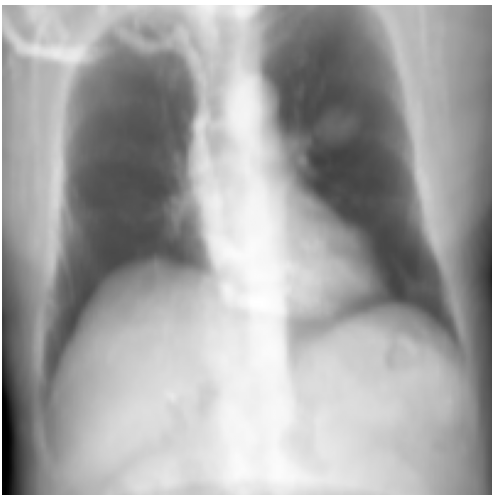

# DeepDRR

*(part of [Methodology](../METHODOLOGY.md))*

DeepDRR segments the volume into a handful of materials and ray-traces each one's exact path
length, combined with an energy-dependent attenuation model and a modeled X-ray spectrum — the
same polychromatic idea as [Monte Carlo](monte_carlo.md), but with exact per-material path lengths
instead of a per-voxel density blend at fixed step intervals.

The DeepDRR papers also describe a second signal: a neural network trained to predict scatter,
added on top of this primary. **That path is not exercised here.** The installed `deepdrr` package
(v1.2.2) has deprecated its scatter simulation — `Projector(..., scatter_num=0)` by default, and
`scatter_num > 0` now raises `DeprecationError` outright — and this repo's wrapper
(`generate_deepdrr_drr` in `src/drr/renderers/deepdrr.py`) doesn't set it, so every DeepDRR render
in this benchmark is primary-transmission only. That makes DeepDRR here closer to "Plastimatch with
segmented materials and a polychromatic spectrum" than to a scatter-including physics model — note
that `CLAUDE.md` and this module's own docstring both still describe DeepDRR as modeling scatter,
which was accurate against the library's original feature set but no longer reflects what
`scatter_num=0` actually renders in the installed version. One more difference worth flagging: this
repo's DeepDRR call also doesn't override the library's default `spectrum='90KV_AL40'` (90 kVp,
4.0 mm Al filtration), so it isn't even modeling the same tube spectrum as Monte Carlo's explicit
80 kVp / 2 mm Al + 0.3 mm Cu model — any beam-hardening difference between the two reflects two
different assumed spectra, not just "exact vs. approximate."

## Algorithm

1. **Segmentation.** Convert density to HU using the same linear map as Plastimatch (Eq. 1), then
   threshold the volume into a small number of discrete materials (air / soft tissue / bone).
2. **Geometry.** Configure the imaging geometry (source-to-detector distance, pixel size) and point
   it at the configured isocenter, view direction, and up vector.
3. **Primary signal.** Ray-trace each material's exact path length through the segmented geometry,
   and combine an energy-dependent attenuation model with the library's default polychromatic
   spectrum (Eq. 2).
4. **No scatter.** Unlike Monte Carlo's Gaussian-blur approximation or DeepDRR's own
   (deprecated) learned scatter path, no second signal is added here — see the note above.
5. **Output.** Report the primary transmission directly as attenuation (Eq. 3).

<figure>

<figcaption>Actual DeepDRR output on the same CT/geometry as the Plastimatch reference. Both are scatter-free primary signals — the visual differences here come from segmentation (only a few discrete materials rather than per-voxel HU) and the assumed 90 kVp/4.0 mm Al spectrum, not from an added scatter haze like Monte Carlo's.</figcaption>
</figure>

<figure>
<svg viewBox="0 0 600 300" width="100%" style="max-width:600px;font-family:-apple-system,Segoe UI,Roboto,sans-serif" role="img" aria-labelledby="ddgov-title ddgov-desc">
<title id="ddgov-title">One pixel, traced back to the segmented ray</title>
<desc id="ddgov-desc">The circled pixel is an exact ray trace through segmented materials, with no scatter added, shown expanded at right.</desc>
<rect x="20" y="20" width="260" height="260" fill="none" stroke="#93c5fd" stroke-width="1.5"></rect>
<image href="../../assets/results/method_crops/deepdrr_small.png" x="20" y="20" width="260" height="260"></image>
<circle cx="150" cy="165" r="7" fill="none" stroke="#facc15" stroke-width="3"></circle>
<path d="M157,165 C230,165 250,150 300,150" stroke="#94a3b8" stroke-width="1.5" stroke-dasharray="4 3" fill="none"></path>
<rect x="300" y="20" width="280" height="260" rx="8" fill="#fafbfc" stroke="#93c5fd" stroke-width="1.5"></rect>
<text x="440" y="40" text-anchor="middle" font-size="11.5" fill="#1e3a5f" font-weight="600">where this pixel's material threshold falls</text>
<path d="M320,138 H332 V162 H320 Z" fill="#f8fafc" stroke="#cbd5e1"></path>
<path d="M332,138 H401 V162 H332 Z" fill="#94a3b8" stroke="#cbd5e1"></path>
<path d="M401,138 H560 V162 H401 Z" fill="#fefce8" stroke="#eab308" stroke-width="2"></path>
<path d="M332,128 V172 M401,128 V172" stroke="#334155" stroke-width="1"></path>
<text x="326" y="122" text-anchor="middle" font-size="9.5" fill="#64748b">air</text>
<path d="M326,124 V136" stroke="#94a3b8" stroke-width="1"></path>
<text x="366" y="122" text-anchor="middle" font-size="9.5" fill="#64748b">soft tissue</text>
<path d="M366,124 V136" stroke="#94a3b8" stroke-width="1"></path>
<text x="480" y="154" text-anchor="middle" font-size="11" fill="#8a6d1f" font-weight="600">bone</text>
<text x="332" y="184" text-anchor="middle" font-size="9.5" fill="#334155" font-weight="600">-800</text>
<text x="401" y="184" text-anchor="middle" font-size="9.5" fill="#334155" font-weight="600">350</text>
<circle cx="415" cy="150" r="4" fill="#facc15" stroke="#1e3a5f" stroke-width="1.5"></circle>
<text x="440" y="200" text-anchor="middle" font-size="10" fill="#334155">HU(ρ) = 4000ρ - 1000 (Eq 1)</text>
</svg>
<figcaption>The exact cutoffs the installed <code>deepdrr</code> library uses for thresholding (<code>load_dicom.conv_hu_to_materials_thresholding</code>): air ≤ -800 HU, soft tissue up to 350 HU, bone above that — note how much of the HU range bone actually spans compared to the narrow soft-tissue band. The circled pixel's underlying voxel (yellow dot) falls just inside the bone region, which is why it's ray-traced with bone's attenuation rather than tissue's.</figcaption>
</figure>

<figure>
<svg viewBox="0 0 360 195" width="100%" style="max-width:360px;font-family:-apple-system,Segoe UI,Roboto,sans-serif" role="img" aria-labelledby="ddgex-title ddgex-desc">
<title id="ddgex-title">Segmented ray path, no scatter added</title>
<desc id="ddgex-desc">A ray crosses a small number of thresholded materials — air, soft tissue, and bone — each ray-traced exactly for the primary signal; no scatter is added on top in this benchmark.</desc>
<defs>
<marker id="ddgex-arrow" viewBox="0 0 10 10" refX="8.5" refY="5" markerWidth="6.5" markerHeight="6.5" orient="auto-start-reverse">
<path d="M0,0 L10,5 L0,10 z" fill="#2b6cb0"></path>
</marker>
</defs>
<rect x="20" y="40" width="40" height="60" fill="#f8fafc" stroke="#cbd5e1"></rect>
<rect x="60" y="40" width="60" height="60" fill="#94a3b8" stroke="#cbd5e1"></rect>
<rect x="120" y="40" width="50" height="60" fill="#fefce8" stroke="#eab308" stroke-width="2"></rect>
<rect x="170" y="40" width="60" height="60" fill="#94a3b8" stroke="#cbd5e1"></rect>
<rect x="230" y="40" width="40" height="60" fill="#f8fafc" stroke="#cbd5e1"></rect>
<path d="M10,70 H290" stroke="#2b6cb0" stroke-width="2" fill="none" marker-end="url(#ddgex-arrow)"></path>
<text x="40" y="112" text-anchor="middle" font-size="10" fill="#64748b">air</text>
<text x="90" y="112" text-anchor="middle" font-size="10" fill="#64748b">tissue</text>
<text x="145" y="112" text-anchor="middle" font-size="10" fill="#8a6d1f" font-weight="600">bone</text>
<text x="200" y="112" text-anchor="middle" font-size="10" fill="#64748b">tissue</text>
<text x="250" y="112" text-anchor="middle" font-size="10" fill="#64748b">air</text>
<rect x="40" y="128" width="280" height="50" rx="8" fill="#f8fafc" stroke="#94a3b8" stroke-width="1.5" stroke-dasharray="5 3"></rect>
<circle cx="66" cy="153" r="13" fill="none" stroke="#94a3b8" stroke-width="2"></circle>
<path d="M57,144 L75,162" stroke="#94a3b8" stroke-width="2"></path>
<text x="92" y="149" font-size="11.5" fill="#475569" font-weight="600">no scatter added</text>
<text x="92" y="165" font-size="9.5" fill="#64748b">deprecated in installed deepdrr</text>
</svg>
<figcaption>Illustrative: the ray (top, Eq 1) crosses only a handful of thresholded materials rather than hundreds of individual voxels — bone (amber) is the dominant attenuator. The DeepDRR papers add a learned scatter network on top of this primary signal, but the installed <code>deepdrr</code> package has deprecated scatter simulation entirely, and this benchmark doesn't work around that — so unlike Monte Carlo's Gaussian-blur approximation, no second signal is added here.</figcaption>
</figure>

## Mathematical Formulation

**(1) Density-to-HU mapping.** Identical to Plastimatch:

$$
\text{HU}(\rho) = 4000\rho - 1000
$$

**(2) Primary signal.** For each material $m$ crossed with path length $l_m$, and each energy bin
$e$ of the modelled spectrum with weight $w_e$:

$$
T_{\text{primary}} = \sum_e w_e\exp\left(-\sum_m \mu_{m,e}\,l_m\right)
$$

the same polychromatic, energy-dependent-$\mu$ structure as [Monte Carlo](monte_carlo.md)'s
per-bin sum, but with exact per-material ray tracing through segmented geometry instead of a
per-voxel density blend at fixed step intervals.

**(3) Attenuation output.** No scatter term is added (see the note above), so the primary signal
is reported directly:

$$
\text{image} = -\log\big(T_{\text{primary}}\big)
$$

matching the attenuation convention shared by every other method. Contrast this with
[Monte Carlo](monte_carlo.md)'s Eq. 7, which adds a scatter term $S$ before this same conversion —
the two methods share the primary-signal math but differ in whether anything is added to it.
