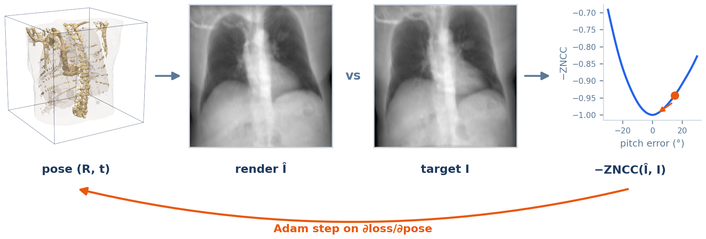
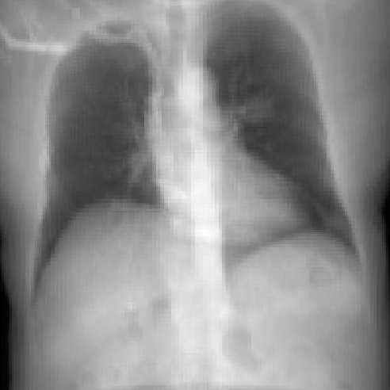
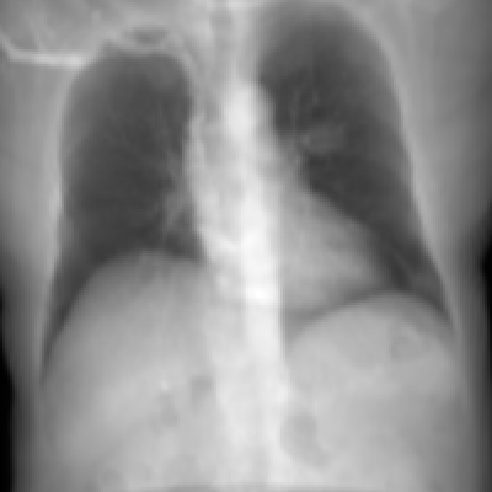
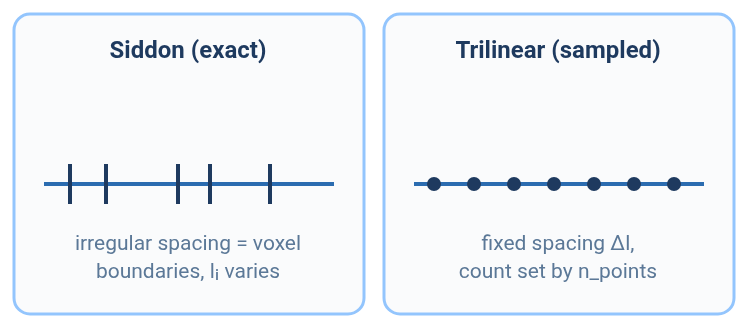
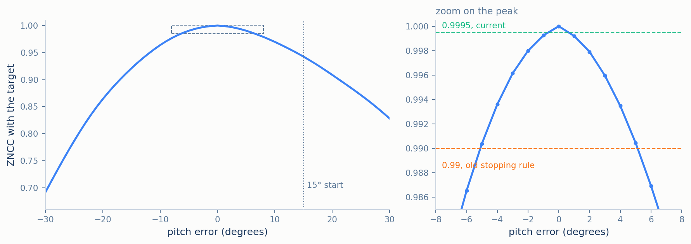

# DiffDRR: Exact Integration You Can Differentiate

*(part of [Methodology](../METHODOLOGY.md))*

DiffDRR [2] computes the same exact line integral as [Plastimatch](plastimatch.md), with the same
algorithm, Siddon's [3]. What it adds is differentiability: every step from the camera pose to the
pixel value is written so that the derivative of the image with respect to the pose can be
computed automatically. That is what makes **2D/3D registration** possible — recovering an unknown
camera pose by repeatedly adjusting it in the direction that makes the rendered image look more
like a target X-ray. Because it integrates the stored density exactly, with no spectrum and no
scatter, it belongs to the *linear* group of [METHODOLOGY.md](../METHODOLOGY.md) §3.3.

<p align="center">
  
  <br><em>Figure 1. DiffDRR in registration (§3). The render at a 15° pitch error is compared with the target by −ZNCC; the curve is the real loss over pitch error, and the gradient step moves the pose towards its minimum. The loop works only because every stage is differentiable.</em>
</p>

## Contents

1. [Pose construction](#1-pose-construction)
2. [Rendering and its derivative](#2-rendering-and-its-derivative)
3. [2D/3D registration](#3-2d3d-registration)
4. [Empirical behaviour](#4-empirical-behaviour)
5. [Limitations](#5-limitations)
6. [Mapping to the code](#6-mapping-to-the-code)
7. [References](#7-references)

---

## 1. Pose construction

Camera placement follows [METHODOLOGY.md](../METHODOLOGY.md) §2 directly: the view and up vectors
give the basis $`(\mathbf{r}, \mathbf{u}', \mathbf{d})`$, and the source sits at
$`\mathbf{S} = \mathbf{I}_w - \mathrm{SAD}\cdot\mathbf{d}`$. The only work specific to DiffDRR is
expressing that pose in its own convention. Its unrotated camera looks along $`-Y`$ with up
$`+Z`$ and right $`-X`$, so the rotation from its frame to the world is the matrix whose columns
are $`-\mathbf{r}`$, $`-\mathbf{d}`$ and $`\mathbf{u}'`$:

```math
R = \begin{pmatrix} -\mathbf{r} & -\mathbf{d} & \mathbf{u}' \end{pmatrix}
```

That matrix is then converted to three Euler angles, rotations about $`Z`$, $`X`$ and $`Y`$ in
that order. Three angles are easier to optimise than nine matrix entries, because any three
angles describe a valid rotation, whereas a matrix has to be kept orthonormal. The translation is
solved so that the camera centre lands on $`\mathbf{S}`$. The matrix is a pure rotation (its
determinant is +1): DiffDRR's base camera points a different way from this suite's, but is not a
mirror image of it. That is why an extra image flip, added on top of this matrix in an earlier
version, produced a mirrored render ([DEVELOPMENT_NOTES.md](../DEVELOPMENT_NOTES.md) §1).

## 2. Rendering and its derivative

### 2.1 Exact mode

The default renderer is Siddon's algorithm, exactly as in [Plastimatch](plastimatch.md) §2: each
ray is cut at every voxel boundary it crosses, and each piece's length $`l_i`$ is computed
exactly. The difference from Plastimatch is the field being integrated. DiffDRR integrates the
stored density itself, with no HU conversion:

```math
\text{pixel} = \sum_i \rho_i\, l_i = \int \rho\, dl
```

By [METHODOLOGY.md](../METHODOLOGY.md) §3.1 this is Plastimatch's output divided by
$`4\mu_{\text{water}}`$, so after normalisation the two should be identical — and are (§4).

**Where the derivative comes from.** Each length $`l_i`$ is a difference of two crossing
parameters times the ray length (Plastimatch §2), and the crossing parameters are ratios of the
source and pixel coordinates. Both are smooth functions of the pose. As the pose changes, the
lengths change smoothly, and so does the pixel. The derivative

```math
\frac{\partial\,\text{pixel}}{\partial\,(\text{angles},\ \mathbf{t})}
```

is therefore defined almost everywhere, and automatic differentiation computes it by applying the
chain rule through these formulas. One subtlety: the *set* of voxels a ray crosses changes
abruptly when the ray passes a voxel corner. A voxel entering or leaving the list does so with
zero length, so the pixel value stays continuous, but its derivative need not be continuous at
such configurations.

<p align="center">
  
  
  <br><em>Figure 2. DiffDRR's two modes on the same CT and geometry as the Plastimatch reference: exact (left, §2.1) and sampled (right, §2.2). They are hard to tell apart by eye.</em>
</p>

### 2.2 Sampled mode

DiffDRR also offers a sampled alternative. It places $`N`$ evenly spaced points between the
point where the ray enters the volume and the detector (500 by default), reads the density at each by trilinear
interpolation, and sums them with the rectangle rule:

```math
\int \rho\, dl \approx \Delta l \sum_{k=1}^{N} \rho(\mathbf{p}_k),
\qquad
\Delta l = \frac{\text{length from volume entry to the detector}}{N-1}
```

On the central ray that is about 0.7 mm per step, about four samples per voxel. This is the same
kind of sum [DVR](dvr.md) computes, with the step length included and measured along the ray
rather than in depth.

<p align="center">
  
  <br><em>Figure 3. Exact mode measures the ray between voxel boundaries, which fall at irregular spacing; sampled mode reads the volume at a fixed spacing and interpolates between voxels.</em>
</p>

Rendering a large image in one pass would need memory proportional to the number of rays, more
than a 24 GB card has at 1024×1024 once gradients are stored. Above 256×256 the renderer
therefore processes the image in patches and joins the results; the output is unchanged
([RESULTS.md](../RESULTS.md) §3).

## 3. 2D/3D registration

**The problem.** Given a target X-ray of a patient whose CT volume is known, find the camera pose
that produced it. With a differentiable renderer this becomes an optimisation: render at a guess,
measure how different the result is from the target, and move the pose to reduce the difference.

**The similarity measure.** Rendered and real X-rays rarely share the same brightness scale, so the
measure must ignore offset and gain. The **zero-normalised cross-correlation** (ZNCC) does: it is
the correlation coefficient between the two images' pixel values, 1 for images identical up to
brightness and contrast. Writing $`\hat I`$ for the rendered image, $`I`$ for the target, and bars
for means over pixels $`p`$, the loss is its negative:

```math
\mathcal{L} =
-\,\frac{\sum_p (\hat I_p - \bar{\hat I})(I_p - \bar I)}
{\sqrt{\sum_p (\hat I_p - \bar{\hat I})^2\ \sum_p (I_p - \bar I)^2}}
```

**The optimiser.** Adam [1] adjusts the three angles and the translation using
$`\partial\mathcal{L}/\partial(\text{angles},\mathbf{t})`$, which §2 makes available.

**The benchmark's experiment.** The target is DiffDRR's own exact-mode render at a reference pose,
at 150×150. The starting guess is that pose rotated 15° about the $`X`$ axis — a pitch error.
Adam runs with learning rate $`10^{-2}`$ until the ZNCC reaches 0.9995, or 300 iterations pass.
Because the target pose is known, the benchmark also records how far the final pose is from it:
the angle of the remaining rotation, and the distance between the final and true source positions.

<p align="center">
  
  <br><em>Figure 4. ZNCC between the reference render and renders at pitch errors from −30° to +30°, with every other pose parameter fixed. The curve is smooth with a single peak at 0°, so gradient descent from 15° heads the right way. The start already scores 0.94, and 0.99 is reached as far as 5° from the peak; 0.9995 only within 1°.</em>
</p>

Figure 4 explains both why registration succeeds and why the stopping threshold matters. The loss
is smooth and has one minimum along this slice, so descent heads the right way. But the curve is
so flat near its peak that a threshold of 0.99 — the benchmark's original choice — is met while the
pose is still 4.5° off. The threshold of 0.9995 was chosen by measuring the pose error against
ZNCC during the descent: of the thresholds tried (0.99, 0.995, 0.999, 0.9995, 0.9999), it is the
loosest at which both renderers end within a quarter of a degree.

## 4. Empirical behaviour

Against the Plastimatch benchmark reference ([RESULTS.md](../RESULTS.md) §4):

| Mode | RMSE | PSNR | SSIM |
|---|---|---|---|
| Exact (Siddon) | below $`10^{-6}`$ | 119 dB | 1.000 |
| Sampled (trilinear) | 0.008 | 42.3 dB | 0.985 |

The exact mode reproduces the benchmark reference to floating-point precision, as §2.1 predicts for the
same algorithm on the same voxel grid; it does so in all six views of the multi-view sweep and at
every resolution from 128 to 1024 pixels ([RESULTS.md](../RESULTS.md) §6–§7). Reaching that
required every renderer to place voxels at exactly the same positions: before the voxel grids were
aligned, a half-voxel offset between DiffDRR and Plastimatch alone held this comparison at RMSE
0.024 and SSIM 0.907 ([DEVELOPMENT_NOTES.md](../DEVELOPMENT_NOTES.md)).

The sampled mode is effectively identical to [DVR](dvr.md), which computes the same trilinear
Riemann sum through a separate implementation: the two agree to three decimals on every metric.
Its remaining difference from the exact mode is the smoothing trilinear interpolation applies at
sharp edges.

In registration, the exact mode reaches ZNCC 0.9995 in 29 iterations and 0.44 s, with 0.20° of
rotation error and 3.0 mm of source-position error remaining ([RESULTS.md](../RESULTS.md) §5).

## 5. Limitations

- **Self-registration only.** The target is rendered by the same renderer from the same volume,
  so there is no mismatch between model and data. Registering against a real X-ray, with scatter,
  noise and a different intensity response, is a harder problem this benchmark does not test.
- **One error axis.** Only a rotation about one axis is perturbed, from a single starting error.
- **No scatter, no spectrum.** Like the benchmark reference, the image is a single-energy line integral.

## 6. Mapping to the code

| Concept | Where it lives |
|---|---|
| Entry point | `build_diffdrr_renderer` (`src/drr/renderers/diffdrr.py`), wrapping the `diffdrr` package's `DRR` |
| §1 rotation and translation | `rotmat_np = np.stack([-r, -d, u], axis=1)`, `matrix_to_euler_angles(..., "ZXY")`, and the `t_x`, `t_y`, `t_z` block in `build_diffdrr_renderer` |
| §2.1 exact mode | `DRR`'s default Siddon renderer; the density comes from the subject built by `make_diffdrr_subject` ([DATA.md](../DATA.md) §2) |
| §2.2 sampled mode | `DRR(..., renderer="trilinear")`, `n_points` at its default of 500; used only in `run_quality` |
| Patch rendering | `_diffdrr_memory_kwargs` (`src/drr/renderers/diffdrr.py`): `patch_size=256` and gradient checkpointing above 256×256 |
| §3 registration | `run_optimization` (`src/drr/benchmarks.py`), threshold `CONVERGENCE = 0.9995`, pose error from `_rotation_error_deg`; loss `zncc_loss` (`src/drr/utils/losses.py`) |

## 7. References

1. D.P. Kingma, J. Ba. Adam: A method for stochastic optimization. *ICLR*, 2015.
2. V. Gopalakrishnan, P. Golland. Fast auto-differentiable digitally reconstructed radiographs for
   solving inverse problems in intraoperative imaging. *Workshop on Clinical Image-Based
   Procedures*, Springer, 2022.
3. R.L. Siddon. Fast calculation of the exact radiological path for a three-dimensional CT array.
   *Medical Physics* 12(2), 1985.
