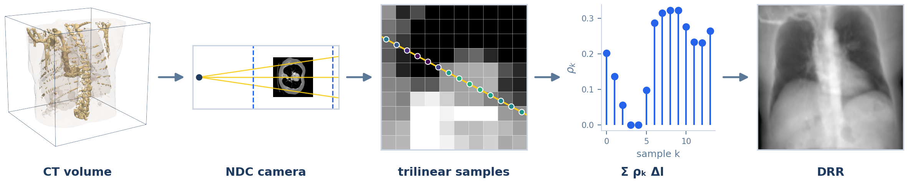
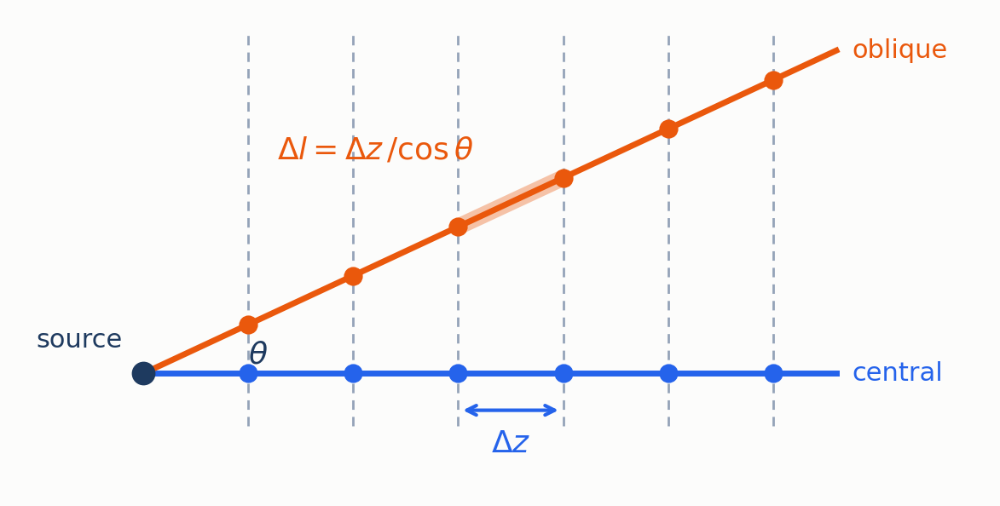
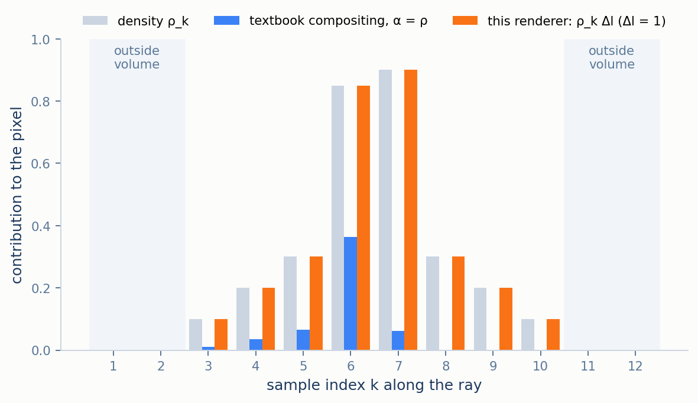
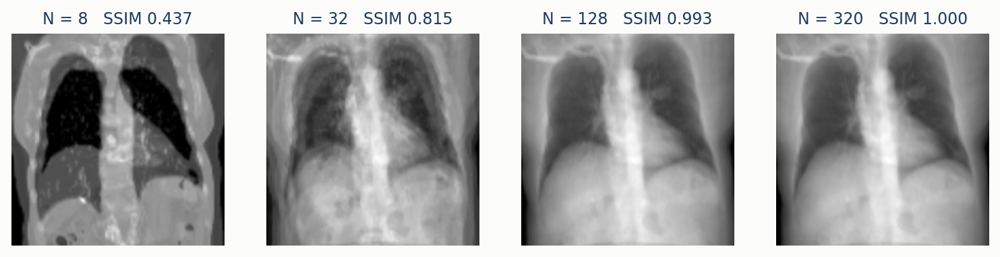
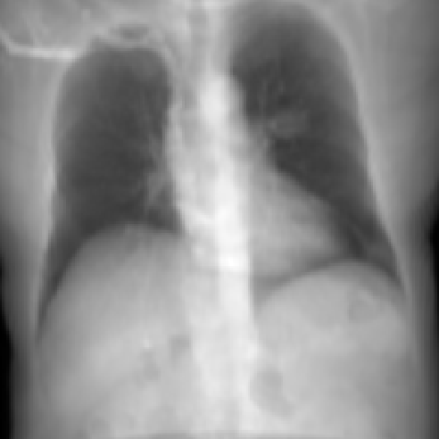

# DVR: A Volume Renderer Used as a Line Integrator

*(part of [Methodology](../METHODOLOGY.md))*

DVR is built on the differentiable volume renderer of PyTorch3D [1], a computer-graphics library
for drawing semi-transparent media such as smoke by compositing samples along each ray. An X-ray
needs something different: every bit of matter along the ray should count equally, with nothing
hiding what lies behind it. This document shows how the renderer is configured to compute exactly
that, a sampled line integral of density. It is sampled rather than exact, models no spectrum and
no scatter, and belongs to the *linear* group of [METHODOLOGY.md](../METHODOLOGY.md) §3.3, next to
Plastimatch and DiffDRR.

<p align="center">
  
  <br><em>Figure 1. DVR's pipeline on the example CT. Dashed lines mark the depth window (§2); the close-up shows evenly spaced trilinear samples along one ray, coloured by sampled density. The fourth stage replaces the library's compositing with a plain line integral (§3).</em>
</p>

## Contents

1. [Camera placement](#1-camera-placement)
2. [Sampling the ray](#2-sampling-the-ray)
3. [What the compositing step computes](#3-what-the-compositing-step-computes)
4. [Empirical behaviour](#4-empirical-behaviour)
5. [Limitations](#5-limitations)
6. [Mapping to the code](#6-mapping-to-the-code)
7. [References](#7-references)

---

## 1. Camera placement

The library places the volume in a normalised cube, $`[-1,1]^3`$, rather than in millimetres, so
the shared geometry of [CONVENTIONS.md](../CONVENTIONS.md) §1 is rescaled into that cube first. A
volume of side $`L`$ millimetres spans 2 normalised units, so every distance is multiplied by
$`2/L`$:

```math
\mathrm{SAD}_{\text{n}} = \mathrm{SAD}\cdot\frac{2}{L},
\qquad
\mathbf{I}_{\text{n}} = \mathbf{I}_w\cdot\frac{2}{L}
```

For the default volume, $`L = 360`$ mm, this puts the source 4.72 units from the isocenter. The
camera's rotation is the look-at basis of [METHODOLOGY.md](../METHODOLOGY.md) §2.1, written in the
library's left–up–forward convention, and its translation puts the camera centre at
$`\mathbf{S}_{\text{n}} = \mathbf{I}_{\text{n}} - \mathrm{SAD}_{\text{n}}\,\mathbf{d}`$. The focal
length in pixels, $`f = \mathrm{SDD}\,W/L`$ ([CONVENTIONS.md](../CONVENTIONS.md) §2), is a ratio of
lengths, so it is computed from millimetres directly.

With the camera in place, every pixel has a ray. The next question is where along it the renderer
looks.

## 2. Sampling the ray

Each ray is sampled at $`N`$ points (320 by default), spaced evenly in *camera depth* — distance
from the source measured along the view direction $`\mathbf{d}`$, not along the ray. The depths
cover

```math
z \in \big[\mathrm{SAD}_{\text{n}} - 2,\ \mathrm{SAD}_{\text{n}} + 2\big]
```

an interval 4 units deep centred on the isocenter. The volume is 2 units deep, so on the central
ray about half the samples, roughly 160, fall inside it, 2.25 mm apart. At each sample point
$`\mathbf{p}_k`$ the density is read by trilinear interpolation from the eight surrounding voxels;
points outside the volume read zero.

Spacing samples evenly in depth has one geometric consequence. A ray leaving the source at angle
$`\theta`$ to the central axis travels $`\Delta z / \cos\theta`$ between consecutive samples, so the
true step length differs from ray to ray:

```math
\Delta l = \frac{\Delta z}{\cos\theta},
\qquad
\Delta z = \frac{4}{N - 1}
```

For the default geometry $`\theta`$ reaches 14° at the image corners, where the step is 3% longer
than on the central ray. §3 uses this step length explicitly.

<p align="center">
  
  <br><em>Figure 2. Sampling in camera depth. Both rays cross the same planes, Δz apart, but the oblique ray (θ = 25° here for clarity; at most 14° by default) travels Δz / cos θ between samples.</em>
</p>

## 3. What the compositing step computes

### 3.1 The textbook model, and why it is wrong for X-rays

A graphics volume renderer treats each sample as a thin, semi-transparent slab with an **opacity**
$`\alpha_k \in [0,1]`$, the fraction of light the slab blocks, and a **colour** $`c_k`$, the light
it emits. Light from sample $`k`$ is dimmed by every slab in front of it, so it reaches the eye with
weight $`T_k\alpha_k`$, where $`T_k`$ is the **transmittance** in front of the sample [2]:

```math
C = \sum_{k=1}^{N} T_k\,\alpha_k\,c_k,
\qquad
T_k = \prod_{j<k}\big(1-\alpha_j\big)
```

This is the right model for fog, where near material hides far material. It is the wrong one for a
radiograph: there, the detector records how much was removed along the *whole* ray, and a dense
structure in front does not hide one behind it. Applied literally, with density as both opacity
and colour, the image would show mainly the first dense structure each ray meets.

### 3.2 The line integral this renderer computes

The renderer's own raymarcher drops the transmittance term and weights each sample by its step
length:

```math
C = \sum_{k} \alpha_k\,c_k\,\Delta l
```

Every benchmark call passes the density volume as the colour field, $`c_k = \rho_k`$, and no
separate opacity volume, in which case the opacity field is 1 inside the volume and, after
interpolation, 0 outside it. Substituting both:

```math
C = \Delta l \sum_{k\,\in\,\text{volume}} \rho(\mathbf{p}_k) \;\approx\; \int \rho\, dl
```

— the Riemann sum of the density line integral, the same quantity Plastimatch computes exactly,
up to the constant of [METHODOLOGY.md](../METHODOLOGY.md) §3.1.

<p align="center">
  
  <br><em>Figure 3. Contribution of each sample to the pixel along one synthetic 12-sample ray. Under textbook compositing with opacity equal to density (blue), samples behind the dense peak at k = 6–7 are almost completely hidden. Under the line integral this renderer computes (orange), each sample contributes its density, so the pixel is the sum of the grey bars.</em>
</p>

### 3.3 How this differs from the code it was ported from

The raymarcher was adapted from an earlier X-ray renderer built on the same library, whose
compositing applied the transmittance product of §3.1 with its shift reversed. With that shift
the product evaluates to 1 for every sample but one, so the code in fact computed
$`\sum_k \alpha_k c_k`$ — already a sum of density, though not because it was written as one. Two
things were missing. The step length was left out, so the $`1/\cos\theta`$ factor of §2 entered
every pixel as a darkening towards the corners, by 3% in the current geometry and by 9% with the
earlier, inflated volume ([DATA.md](../DATA.md) §1.3). And the code described itself as
back-to-front compositing, which it did not perform. The current raymarcher computes §3.2's sum
directly.

## 4. Empirical behaviour

If §3 is right, DVR's output is a Riemann sum, so it should converge as $`N`$ grows and stop
changing once the samples are dense compared with the voxels.

<p align="center">
  
  <br><em>Figure 4. Renders of the example CT at increasing sample count N, each scored by SSIM against an N = 512 render. At N = 8 only about four samples land inside the volume and fine structure is lost (SSIM 0.44); by N = 128, about one sample per two voxels on the central ray, the image has converged (SSIM 0.99).</em>
</p>

It does, and at the sample density where interpolating between samples stops missing structure —
the behaviour of an integral being discretised. The default, $`N = 320`$, is past that point.

<p align="center">
  
  <br><em>Figure 5. DVR's output at the default N = 320, on the same CT and geometry as the Plastimatch reference.</em>
</p>

Against the Plastimatch benchmark reference this render has RMSE 0.008 and SSIM 0.985
([RESULTS.md](../RESULTS.md) §4). Those are, to three decimals, the scores of DiffDRR's sampled
trilinear mode, which computes the same trilinear Riemann sum by a completely separate
implementation ([DiffDRR](diffdrr.md) §2.2) — direct confirmation of §3.2. The remaining
difference from the exact integral is consistent with the smoothing trilinear interpolation applies at
sharp edges, which grows as output pixels shrink relative to voxels: SSIM is 0.990 at 128×128 and 0.969 at
1024×1024 ([RESULTS.md](../RESULTS.md) §7). Across the six views of the multi-view sweep DVR stays
between 0.985 and 0.993 ([RESULTS.md](../RESULTS.md) §6).
Because every operation above is differentiable, DVR is also one of the two renderers used for
pose registration, where it recovers a 15° error to within 0.2° in 29 iterations
([RESULTS.md](../RESULTS.md) §5).

## 5. Limitations

- **Sampled, not exact.** Trilinear interpolation smooths sharp edges slightly; the renderer cannot
  reproduce the voxel-exact lengths of Siddon's algorithm.
- **Fixed depth window.** Samples cover $`\mathrm{SAD} \pm L`$ along the view direction. A volume
  that is not centred on the isocenter by much more than $`L/2`$ would be partly cut off.
- **Memory grows with samples.** Every sample of every ray is held for the backward pass: about
  17 GB at 1024×1024 with 320 samples ([RESULTS.md](../RESULTS.md) §3).

## 6. Mapping to the code

| Concept | Where it lives |
|---|---|
| Entry point | `build_dvr_renderer` (`src/drr/renderers/dvr.py`), returning an `ObjectCentricXRayVolumeRenderer` and its `PerspectiveCameras` |
| §1 normalised camera | `build_dvr_renderer`: `sdd_ndc`, `sad_ndc`, `R`, `T`, focal length `fx`, `fy` |
| §2 depth range and sample count | `min_depth = sad_ndc - 2`, `max_depth = sad_ndc + 2`, `n_pts_per_ray` (default 320, `--n-pts`); PyTorch3D's `NDCMultinomialRaysampler`, un-stratified |
| §3.2 constant opacity | `BaseXRayVolumeRenderer.forward`, `opacity=None` branch; every call in `src/drr/benchmarks.py` uses it |
| §3.2 line integral | `AbsorptionEmissionRaymarcher.forward`: per-ray step from `ray_bundle.lengths` and `ray_bundle.directions` |
| §4 sample-count sweep | `run_dvr_sampling_ablation` (`src/drr/benchmarks.py`), `--dvr-npts` |

## 7. References

1. N. Ravi et al. Accelerating 3D Deep Learning with PyTorch3D. *arXiv:2007.08501*, 2020.
2. N. Max. Optical models for direct volume rendering. *IEEE Transactions on Visualization and
   Computer Graphics* 1(2), 1995.
