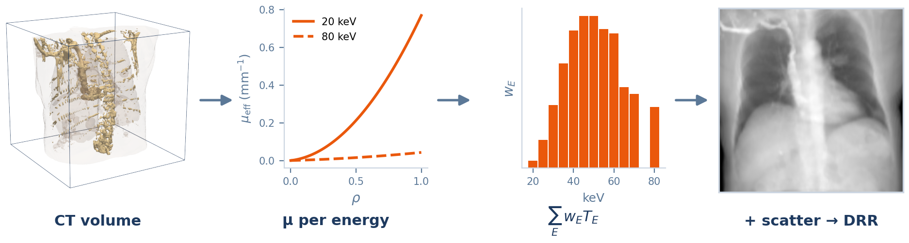
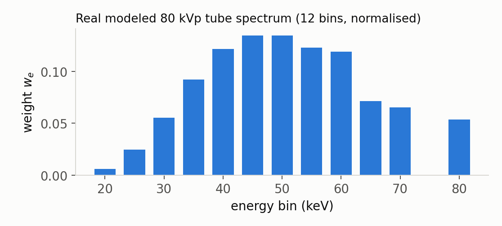
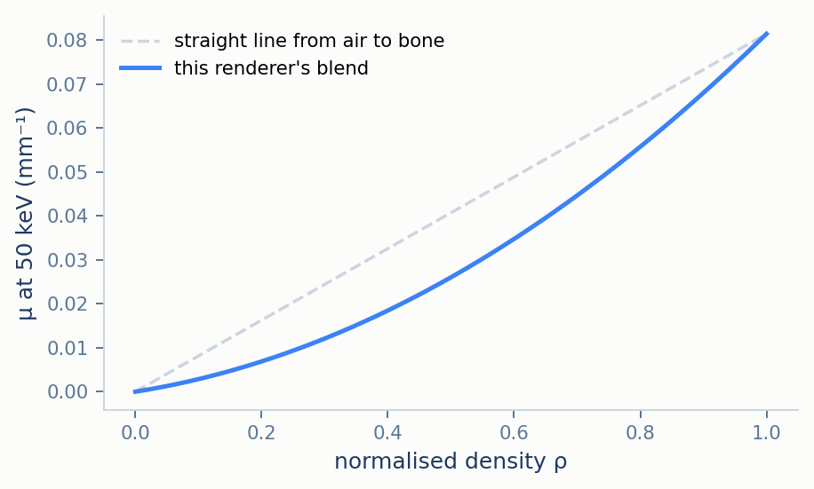
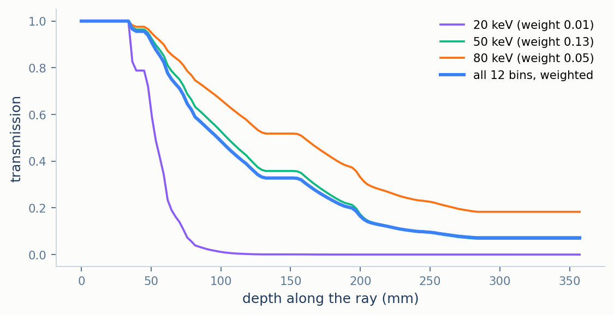
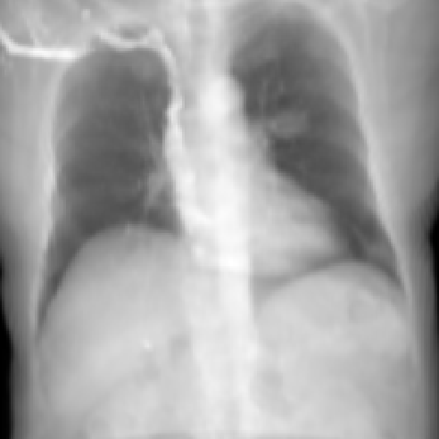

# Monte Carlo: Polychromatic Ray Marching with Approximate Scatter

*(part of [Methodology](../METHODOLOGY.md))*

This renderer is the suite's attempt at a more realistic radiograph than the benchmark reference: it
models a 12-bin X-ray tube spectrum, gives soft tissue and bone their own energy-dependent
attenuation, and adds an approximate scatter haze. Despite its name, it is not a Monte Carlo
simulation. Nothing in it is random: each ray is marched deterministically, and scatter is a
fixed blur rather than tracked photons. The name is kept only for continuity with the code. Being
polychromatic and including a scatter term, it belongs to the *non-linear* group of
[METHODOLOGY.md](../METHODOLOGY.md) §3.3. It illustrates what beam hardening and scatter do to an
image; it is not a measure of accuracy.

The sections follow one ray through the renderer: the spectrum it carries, how each sample
attenuates it, how the samples are taken, how the energy bins are recombined, and how scatter is
added.

<p align="center">
  
  <br><em>Figure 1. Monte Carlo's pipeline. Attenuation depends on energy (shown for the lowest and highest bin), so the ray march is repeated once per bin, and only the resulting transmissions are combined with the spectrum weights — the step that makes the model polychromatic. A scatter blur is added before the final image.</em>
</p>

## Contents

1. [The spectrum](#1-the-spectrum)
2. [Attenuation at one sample](#2-attenuation-at-one-sample)
3. [Marching the ray](#3-marching-the-ray)
4. [Recombining the spectrum: beam hardening](#4-recombining-the-spectrum-beam-hardening)
5. [Scatter and the final image](#5-scatter-and-the-final-image)
6. [Empirical behaviour](#6-empirical-behaviour)
7. [Limitations](#7-limitations)
8. [Mapping to the code](#8-mapping-to-the-code)
9. [References](#9-references)

---

## 1. The spectrum

A tube operated at 80 kVp emits photons at every energy up to 80 keV. This renderer represents
that continuous spectrum by 12 energy bins: 20 to 60 keV in 5 keV steps, then 65, 70 and 80 keV.
Each bin $`E`$ carries a weight $`w_E`$, the fraction of photons at that energy, normalised so
that

```math
\sum_E w_E = 1
```

The weights are a fixed table, modelled on a tungsten-anode tube with 2 mm of aluminium and
0.3 mm of copper filtration. The filtration removes most low-energy photons before they reach the
patient, which is why the 20 keV bin carries almost no weight.

<p align="center">
  
  <br><em>Figure 2. The 12 normalised bin weights. Most photons are between 35 and 60&nbsp;keV; the mean energy is 51&nbsp;keV.</em>
</p>

Every later step is carried out separately for each bin, starting with how much a single sample
attenuates a photon of that energy.

## 2. Attenuation at one sample

The renderer knows two materials, soft tissue (modelled as water) and cortical bone. For each,
the attenuation at bin energy $`E`$ is the material's tabulated mass attenuation coefficient [1]
multiplied by its physical density, 1.00 g/cm³ for water and 1.92 g/cm³ for cortical bone:

```math
\mu_{\text{tissue},E} = \Big(\frac{\mu}{\rho}\Big)_{\text{water},E} \cdot 1.00,
\qquad
\mu_{\text{bone},E} = \Big(\frac{\mu}{\rho}\Big)_{\text{bone},E} \cdot 1.92
```

The tables hold the NIST values at the bins NIST tabulates (20, 30, 40, 50, 60 and 80 keV), and
log–log interpolation between them for the others. At 50 keV that gives 0.0227 mm⁻¹ for tissue
and 0.0814 mm⁻¹ for bone.

A sample with normalised density $`\rho_k`$ is treated as a mixture: the fraction $`\rho_k`$ is
bone and the rest tissue, and the result is scaled by $`\rho_k`$ once more,

```math
\mu_{\text{eff},k} = \rho_k\Big(\rho_k\,\mu_{\text{bone},E} + (1-\rho_k)\,\mu_{\text{tissue},E}\Big)
```

The outer factor makes air, $`\rho_k = 0`$, attenuate nothing; without it, air would attenuate
like soft tissue. The price is that the blend is quadratic in $`\rho_k`$, so medium densities
attenuate less than a straight-line blend would suggest. It is a heuristic, not a calibration:
water itself, at $`\rho = 0.25`$, comes out at 0.0093 mm⁻¹ at 50 keV, well under the 0.0227 mm⁻¹
of the water table.

<p align="center">
  
  <br><em>Figure 3. The blend above at 50&nbsp;keV (blue), against a straight line from air to bone (dashed). A sample at ρ = 0.5 attenuates at 0.026&nbsp;mm⁻¹, under a third of bone's 0.081.</em>
</p>

With the attenuation of one sample defined, the next question is where the samples are taken.

## 3. Marching the ray

Each ray runs from the source to one detector pixel. The renderer first finds where the ray
enters the volume's bounding box and where it leaves it or reaches the detector, whichever comes
first — the same slab test as the first step of
[Plastimatch](plastimatch.md) §2 — and places $`N`$ samples (128 by default) evenly over that
segment, at its midpoints $`t_k = t_{\text{in}} + (k + \tfrac12)(t_{\text{out}} - t_{\text{in}})/N`$.
On the central ray that is one sample every 2.7 mm, about one per voxel. Each sample reads the density
by trilinear interpolation of the eight surrounding voxels, and samples outside the volume read
zero. Density does not depend on energy, so it is sampled once and reused for all 12 bins.

The line integral for bin $`E`$ is the Riemann sum of the sample attenuations times the step
length, and its transmission follows from Beer–Lambert:

```math
\int \mu_E\, dl \approx \Delta l \sum_k \mu_{\text{eff},k},
\qquad
\Delta l = \frac{(t_{\text{out}} - t_{\text{in}})\,\lVert \mathbf{p}_1 - \mathbf{p}_0 \rVert}{N},
\qquad
T_E = \exp\Big(-\int \mu_E\, dl\Big)
```

where $`\mathbf{p}_0`$ is the source and $`\mathbf{p}_1`$ the pixel.

## 4. Recombining the spectrum: beam hardening

The primary transmission is the spectrum-weighted average of the 12 per-bin transmissions:

```math
T_{\text{primary}} = \sum_E w_E\,T_E = \sum_E w_E \exp\Big(-\int \mu_E\, dl\Big)
```

This is a sum of exponentials that decay at different rates, not a single exponential. Low-energy
bins are attenuated much faster than high-energy ones, so the deeper a ray goes, the more of what
survives is high-energy, and the more slowly the remaining beam is attenuated. That is beam
hardening. Its visible effect is that $`-\log T_{\text{primary}}`$ grows less than linearly with
the amount of tissue crossed.

<p align="center">
  
  <br><em>Figure 4. Transmission against depth along the same ray as <a href="plastimatch.md">Plastimatch's Figure&nbsp;3</a>, for three of the 12 bins and for the weighted total. By 150&nbsp;mm the 20&nbsp;keV bin is down to 0.1%, while the 80&nbsp;keV bin keeps 52%; at the far side of the body the total is 7%, against 18% for the 80&nbsp;keV bin alone.</em>
</p>

## 5. Scatter and the final image

Scattered photons reach the detector from many directions, so they add a smooth haze rather than
a sharp image. The renderer approximates that haze by taking the fraction of the beam that was
removed, $`1 - T_{\text{primary}}`$, scaling it by a scatter fraction $`f`$ (0.12 by default),
and blurring it over the detector with a Gaussian whose standard deviation is
$`\sigma = 15`$ mm by default:

```math
S = G_\sigma * \big(f\,(1 - T_{\text{primary}})\big)
```

where $`*`$ is a 2D convolution. The width is specified in millimetres on the detector and
converted to pixels with the pixel pitch, so the haze has the same physical extent at every output
resolution. Adding $`S`$ and converting to attenuation gives the image:

```math
\text{image} = -\log\Big(\mathrm{clip}\big(T_{\text{primary}} + S,\ 10^{-6},\ 1\big)\Big)
```

The haze raises the transmission most where the primary is darkest, behind thick anatomy, so it
lowers contrast there. The renderer can also add Poisson noise, but the benchmark never enables
it.

## 6. Empirical behaviour

<p align="center">
  
  <br><em>Figure 5. The renderer's output on the same CT and geometry as the Plastimatch reference.</em>
</p>

Compared with the benchmark reference, contrast is softer: the lung fields and the sides of the body are
brighter relative to the mediastinum. Edges stay sharp, because the blur of §5 applies only to the
added scatter term. Against Plastimatch the render has the largest RMSE of the five, 0.102, and the
lowest SSIM, 0.946 ([RESULTS.md](../RESULTS.md) §4) — though the SSIM is much closer to the others
than the RMSE, because the two metrics measure different things. The pixel-by-pixel comparison in
[METHODOLOGY.md](../METHODOLOGY.md) §5 shows Monte Carlo's pixels on a smooth concave curve
against the benchmark reference's: a large, systematic difference in intensity, which RMSE counts in
full, but one that preserves local structure, which is what SSIM measures. The difference may
come from the spectrum, the density blend of §2 and the scatter approximation together; the
experiments here do not separate them. Across the six views of
the multi-view sweep its SSIM stays between 0.90 and 0.96 ([RESULTS.md](../RESULTS.md) §6), and it
is the same at every output resolution, since the scatter blur is specified in millimetres
([RESULTS.md](../RESULTS.md) §7).

## 7. Limitations

- **Scatter is a heuristic.** Real scatter depends on the patient's thickness, the field size and
  the distance to the detector. Here it is a fixed fraction and a fixed blur, so it only conveys
  the qualitative effect.
- **Two materials, and density read as a bone fraction.** Every sample is a blend of water and
  cortical bone (§2); lung, fat and contrast agents have no tables of their own, and the blend
  uses the normalised density directly, so even water is treated as a quarter bone.
- **Not stochastic.** Despite the name, every image is deterministic; nothing is sampled at
  random unless the optional noise is switched on.

## 8. Mapping to the code

| Concept | Where it lives |
|---|---|
| Entry point | `generate_mc_drr` (`src/drr/renderers/monte_carlo.py`) |
| §1 spectrum | `_ENERGY_BINS_KEV`, `_SPECTRUM_WEIGHTS_RAW`, `_spectrum_weights()` |
| §2 attenuation tables | `_MU_RHO_WATER`, `_MU_RHO_BONE`, `_RHO_WATER`, `_RHO_BONE`, giving `_MU_TISSUE_MM`, `_MU_BONE_MM`; the blend is `_transmission()` |
| §3 ray march | `_sample_density()` (slab test, trilinear `scipy.ndimage.map_coordinates`); detector geometry from `_build_detector_pixels()`; sample count `n_pts` (default 128) |
| §4 recombination | The weighted loop over bins in `generate_mc_drr` |
| §5 scatter and noise | `scatter_fraction` (0.12), `scatter_sigma_mm` (15.0), `add_quantum_noise` (off), `n_photons` |

## 9. References

1. J.H. Hubbell, S.M. Seltzer. Tables of X-Ray Mass Attenuation Coefficients and Mass
   Energy-Absorption Coefficients. *NIST Standard Reference Database 126*, National Institute of
   Standards and Technology. (Water and cortical bone, ICRU-44.)
2. J.T. Bushberg, J.A. Seibert, E.M. Leidholdt, J.M. Boone. *The Essential Physics of Medical
   Imaging*, 4th ed. Wolters Kluwer. (Tube spectra, beam hardening, Compton scatter.)
