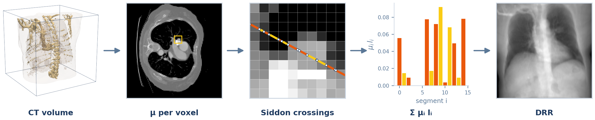
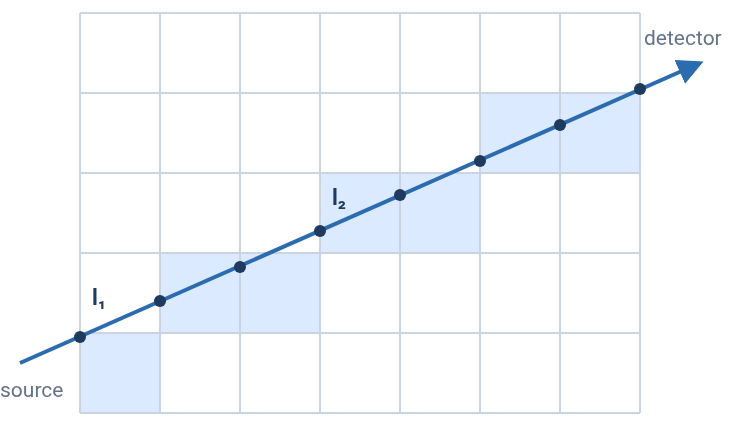
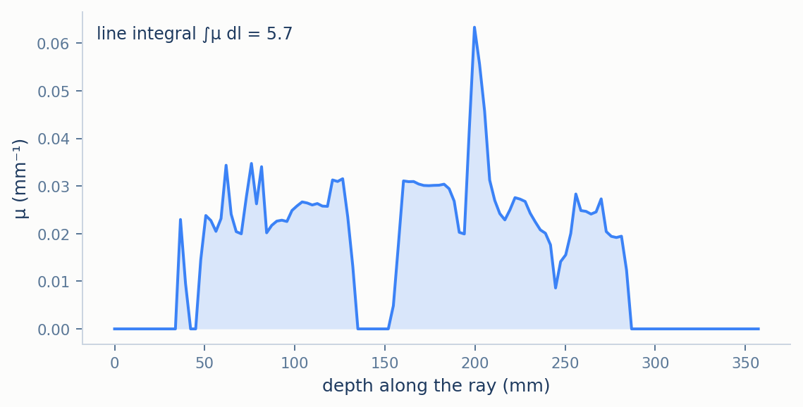
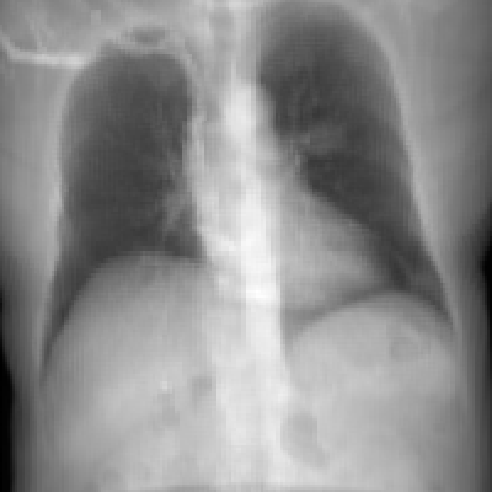

# Plastimatch: Exact Ray–Voxel Integration

*(part of [Methodology](../METHODOLOGY.md))*

Plastimatch is the benchmark reference every other renderer in this suite is scored against. It
evaluates the single-energy line integral of [METHODOLOGY.md](../METHODOLOGY.md) §1 exactly, with
Siddon's ray–voxel intersection algorithm [3]: for every ray it finds the true length of the ray
inside each voxel, so no sampling step and no interpolation enter the result. It models no
spectrum and no scatter. Because its attenuation is proportional to the stored density, it is the
reference member of the *linear* group of [METHODOLOGY.md](../METHODOLOGY.md) §3.3.

<p align="center">
  
  <br><em>Figure 1. Plastimatch's pipeline on the example CT. The close-up follows one ray through the boxed 10×10-voxel patch; each coloured segment is one exact ray–voxel length, and the bars are μᵢlᵢ for those segments. The lengths are exact; the voxel representation (attenuation constant inside each voxel) and the linear HU calibration are modelling assumptions.</em>
</p>

## Contents

1. [Density to attenuation](#1-density-to-attenuation)
2. [Exact ray–voxel intersection](#2-exact-rayvoxel-intersection)
3. [The line integral and the output](#3-the-line-integral-and-the-output)
4. [Empirical behaviour](#4-empirical-behaviour)
5. [Limitations](#5-limitations)
6. [Mapping to the code](#6-mapping-to-the-code)
7. [References](#7-references)

---

## 1. Density to attenuation

Plastimatch reads a CT volume in Hounsfield units, so the stored density $`\rho \in [0,1]`$ is
first decoded with $`\mathrm{HU} = 4000\rho - 1000`$, which recovers the scan's original HU between
−800 and 3000 ([DATA.md](../DATA.md) §1.2). Plastimatch then converts each voxel's HU value to a linear
attenuation coefficient with the standard calibration [2], except that it treats everything at or
below −800 HU as air:

```math
\mu(\mathrm{HU}) =
\begin{cases}
0, & \mathrm{HU} \le -800 \\
\mu_{\text{water}}\left(1 + \dfrac{\mathrm{HU}}{1000}\right), & \mathrm{HU} > -800
\end{cases}
\qquad
\mu_{\text{water}} = 0.022\ \text{mm}^{-1}
```

Both details come from Plastimatch's source code, whose comment gives the reason for the
constant: the mass attenuation coefficient of water at 50 keV is 0.22 cm²/g [1], which for
density 1 g/cm³ is 0.22 cm⁻¹, or 0.022 mm⁻¹. That is a diagnostic-radiography energy. The formula
was also checked by rendering slabs of a single material at several thicknesses: the recovered
$`\mu`$ does not depend on thickness and grows linearly with HU, exactly as above.

Combined with the density encoding, the two cases collapse into one:

```math
\mu = 4\,\mu_{\text{water}}\,\rho
```

for every voxel, because the encoding stores exactly 0 wherever the cutoff applies. The value of
$`\mu_{\text{water}}`$ therefore only scales the whole image, and the min–max normalisation applied
before every comparison removes any scale ([METHODOLOGY.md](../METHODOLOGY.md) §3.2). What
remains to be computed is the integral itself.

## 2. Exact ray–voxel intersection

Inside one voxel, attenuation is constant, so the integral along a ray is exactly a sum: each
voxel's $`\mu`$ times the length of the ray inside that voxel. Siddon's algorithm [3] finds those
lengths without stepping along the ray.

Write the ray from the source $`\mathbf{p}_0`$ to a detector pixel $`\mathbf{p}_1`$ as

```math
\mathbf{p}(\alpha) = \mathbf{p}_0 + \alpha\,(\mathbf{p}_1 - \mathbf{p}_0),
\qquad \alpha \in [0,1]
```

The voxel grid is bounded by evenly spaced planes perpendicular to the $`X`$, $`Y`$ and $`Z`$
axes. The algorithm proceeds in four steps.

**1. Clip to the volume.** Intersecting the ray with the grid's six outer faces gives the values
$`\alpha_{\min}`$ and $`\alpha_{\max}`$ at which it enters and leaves the volume.

**2. List the plane crossings.** Within $`[\alpha_{\min}, \alpha_{\max}]`$ the ray crosses each
family of parallel planes at evenly spaced values of $`\alpha`$, because the planes are evenly
spaced. Each family therefore gives an arithmetic sequence, computed directly.

**3. Merge.** Sorting the three sequences into one list
$`\alpha_{\min} = \alpha_0 < \alpha_1 < \dots < \alpha_n = \alpha_{\max}`$ splits the ray into
segments that each lie inside exactly one voxel.

**4. Measure each segment.** The midpoint of segment $`k`$, $`\mathbf{p}\big((\alpha_k +
\alpha_{k+1})/2\big)`$, lies strictly inside one voxel and so identifies it. The segment's length
is

```math
l_k = (\alpha_{k+1} - \alpha_k)\,\lVert \mathbf{p}_1 - \mathbf{p}_0 \rVert
```

Every $`l_k`$ is a true geometric distance, not an estimate from a step size, and nothing is
interpolated. The number of segments equals the number of voxels the ray crosses, so the cost per
ray grows linearly with the volume's size, and there is no sample count to choose: a thin
structure cannot fall between two samples, because there are no samples.

<p align="center">
  
  <br><em>Figure 2. Siddon's algorithm on a small 2D grid. The ray is cut at every grid line it crosses, and each piece is measured exactly. On this benchmark's 128-voxel volume, the central ray crosses 128 voxels.</em>
</p>

## 3. The line integral and the output

Summing each segment's attenuation times its length gives the line integral. Since attenuation is
constant inside each voxel, this sum *is* the integral of the voxelised volume, not an
approximation to it:

```math
\int \mu\, dl = \sum_k \mu_k\, l_k
```

<p align="center">
  
  <br><em>Figure 3. Attenuation along one ray of the example CT, running parallel to the AP view direction, with §1's calibration applied. The ray passes close to the spine. The shaded area is the line integral, about 5.7, so only 0.3% of a 50&nbsp;keV beam would survive; the tall spike near 200&nbsp;mm is bone, and the gap between 135 and 152&nbsp;mm is lung below −800&nbsp;HU, which §1 treats as air.</em>
</p>

Plastimatch can report either the line integral itself or the transmission
$`T = \exp\left(-\int \mu\, dl\right)`$. This benchmark uses its default, the line integral, which
is the attenuation display convention of [METHODOLOGY.md](../METHODOLOGY.md) §1. This
convention was verified by requesting the transmission output and comparing it with
$`\exp(-\text{line integral})`$ computed from the default output. The values agreed to six decimal
places, so the default output is the Beer–Lambert exponent and nothing else.

## 4. Empirical behaviour

<p align="center">
  
  <br><em>Figure 4. Plastimatch's output on the example chest CT (200×200, AP view), the reference image for every comparison in <a href="../RESULTS.md">RESULTS.md</a>.</em>
</p>

Three properties of this image follow from §1–§3. Ribs and vertebral edges are sharp, because
§2's exact lengths introduce no smoothing along the ray. Nothing is hazy around dense structures,
because no scatter is modelled. And bone is bright while air is dark, because the image is the
line integral of an attenuation that grows with density.

The other two members of the linear group compute the same integral: [DiffDRR](diffdrr.md) with
the same algorithm, [DVR](dvr.md) by sampling. DiffDRR reproduces this image to floating-point
precision, and DVR to an RMSE of 0.008 ([RESULTS.md](../RESULTS.md) §4).

## 5. Limitations

- **Single energy, no scatter.** As the reference for this benchmark, which compares how
  accurately renderers integrate the same density field in the same geometry, this is the right
  choice. It is not a realistic radiograph: real diagnostic images show beam hardening and
  scatter, which [Monte Carlo](monte_carlo.md) and [DeepDRR](deepdrr.md) attempt to model.
- **One energy for every tissue.** §1 scales water's 50 keV attenuation by HU, which assumes every
  tissue's attenuation varies with energy the way water's does. Bone does not — it attenuates
  relatively more at low energy — so bone-to-tissue contrast in this image is not exactly that of
  a 50 keV radiograph. This does not affect any normalised comparison with the renderers that
  integrate the same density.
- **Lung below −800 HU is air.** The cutoff of §1 removes the attenuation of most lung tissue.
  The density encoding applies the same cutoff, so every renderer sees the same thing
  ([DATA.md](../DATA.md) §1.2).
- **CPU only, through an external program.** Plastimatch is invoked as a separate process for
  every render, which makes it the reference rather than a practical renderer here; it is not in
  the speed or memory benchmarks.

## 6. Mapping to the code

| Concept | Where it lives |
|---|---|
| Entry point | `generate_plastimatch_drr` (`src/drr/renderers/plastimatch.py`), which writes the volume to disk and runs the external `plastimatch drr` command; no ray tracing runs in this repository's Python |
| §1 density to HU | `density_to_hu` (`src/drr/data.py`), applied before the volume is written for the command to read |
| §1 HU to attenuation | Plastimatch's default `-P preprocess`; the lookup is `attenuation_lookup_hu` in Plastimatch's `src/reconstruct/drr.cxx` |
| §2 exact intersection | `plastimatch drr -i exact` (the command also offers `-i uniform`, a fixed-step sampler, unused here) |
| §3 output convention | No `-e` flag: line integral; adding `-e` gives the transmission |
| Shared geometry | `--sid` (SDD), `--sad`, `-o` (isocenter), `-n` (detector normal, $`-\mathbf{d}`$), `--vup`, `-z` (detector size $`L`$); see [CONVENTIONS.md](../CONVENTIONS.md) §7.1 |
| Temporary files | Written under the home directory, because a snap-confined Plastimatch cannot see the host's `/tmp` ([DEVELOPMENT_NOTES.md](../DEVELOPMENT_NOTES.md)) |

## 7. References

1. J.H. Hubbell, S.M. Seltzer. Tables of X-Ray Mass Attenuation Coefficients and Mass
   Energy-Absorption Coefficients. *NIST Standard Reference Database 126*, National Institute of
   Standards and Technology.
2. J.T. Bushberg, J.A. Seibert, E.M. Leidholdt, J.M. Boone. *The Essential Physics of Medical
   Imaging*, 4th ed. Wolters Kluwer.
3. R.L. Siddon. Fast calculation of the exact radiological path for a three-dimensional CT array.
   *Medical Physics* 12(2), 1985.
